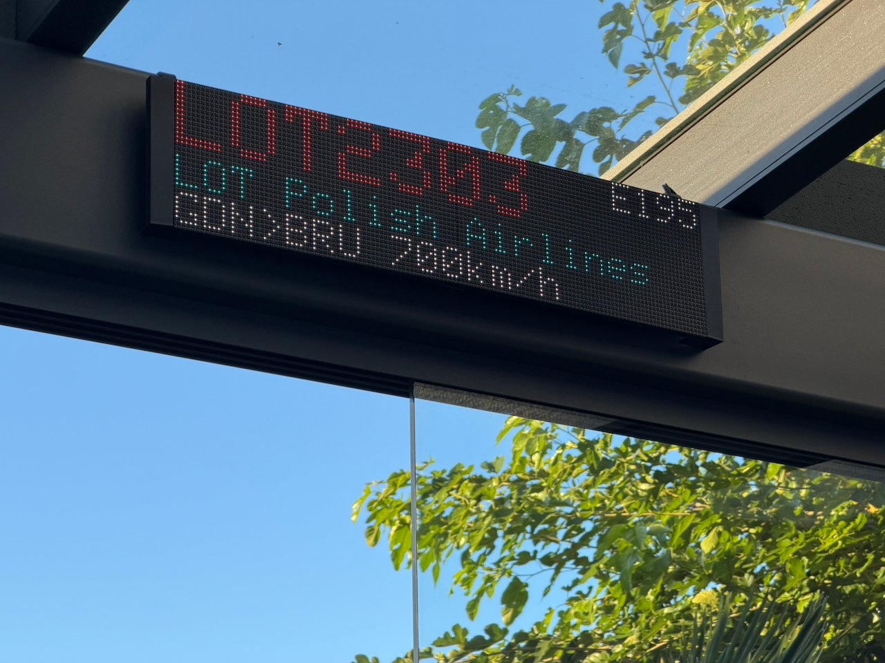
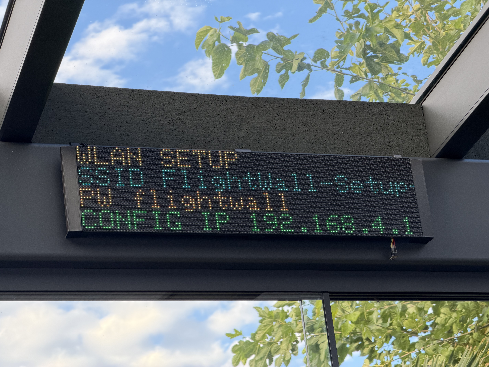

# FlightWall MatrixPortal

FlightWall macht aus einem Adafruit MatrixPortal S3 und zwei HUB75-Panels eine
eigenständige Flugzeuganzeige. Alternativ läuft derselbe Serverkern auf einem
ESP32-S3-N16R8 ohne LED-Matrix; in dieser Variante dient die responsive
FlightWall-Webseite als Anzeige. Der ESP32-S3 liest ADS-B-Daten direkt ein,
wählt das relevanteste Flugzeug aus und ergänzt Route sowie Klartexte. Ein
Raspberry Pi oder separater FlightMatrixServer ist nicht erforderlich.



**Neu hier?** Die Anleitung [Getting Started](GETTING_STARTED.md) führt vom
Hardwareaufbau über die Ersteinrichtung bis zur ersten Flugzeuganzeige und
erklärt auch BME280, BH1750, MQTT, Routenauflösung und OTA.

## Aktueller Stand

| Merkmal | Stand |
|---|---|
| Firmware | `3.6.0-dual-target.1` |
| Controller | Adafruit MatrixPortal S3 oder ESP32-S3 DevKitC-1 N16R8 |
| Anzeige | 2 × 64×32 HUB75, horizontal verkettet |
| Gesamtauflösung | 128×32 Pixel |
| Farbtiefe | 3 Bit je Farbkanal |
| Framework | Arduino über PlatformIO |
| Bedienoberfläche | Deutsch und Englisch |
| Aktualisierung | USB, Web-OTA oder PlatformIO-OTA |
| Lizenz | MIT |

## Eindrücke aus dem Betrieb

Die folgende Aufnahme zeigt den automatischen WLAN-Rückfallmodus direkt auf
der Matrix. SSID, Passwort und Konfigurationsadresse bleiben dadurch auch ohne
Zugriff auf den seriellen Monitor sichtbar.



[▶ Video: Flugzeuganzeige im laufenden Betrieb (MOV, ca. 22 MB)](IMG_4794.mov)

Das Video zeigt den realen Aufbau mit Callsign, Flugzeugtyp, CPA sowie
Annäherungsinformation. GitHub öffnet die MOV-Datei je nach Browser direkt oder
bietet sie zum Herunterladen an.

Wesentliche Funktionen:

- direkte Verarbeitung lokaler readsb-/dump1090-Daten und der externen
  adsb.fi-API
- Auswahl des nächsten geeigneten Flugzeugs einschließlich CPA-Berechnung
- konfigurierbare Filter für Kleinflugzeuge und Maximalhöhe
- bevorzugte Behandlung interessanter Flugzeuge und Transpondernotfälle
- Routenauflösung über adsb.im mit kostenlosem ADSBDB-Fallback und
  verwaltetem RAM-/Flash-Cache
- vollständige Multi-Hop-Routen und kompakte Darstellung geschlossener Umläufe
- integrierte Flughafen- und Airline-Klartexte
- sieben frei auswählbare und sortierbare Matrixseiten
- responsive Webanzeige für iPhone, Tablet und Desktop
- deutsch/englisch umschaltbare Matrix- und Weboberfläche
- BME280-Klimawerte, Schimmelrisiko und optionale MQTT-Wetterdaten
- BH1750-Helligkeitsautomatik mit sieben stabilen Helligkeitsstufen
- umfangreiche Status-, Test- und Diagnosefunktionen
- änderbare WLAN-Zugangsdaten mit geschütztem Einrichtungsnetz als Rückfallweg
- Dual-Core-Betrieb mit voneinander getrennter Anzeige und Netzverarbeitung

## Systemaufbau

```text
readsb / dump1090 ─┐
                   ├─> ADS-B-Auswahl ─> Route/Klartexte ─> LED-Matrix
adsb.fi ───────────┘          │                  │
                              ├─> Web-Display    ├─> Routencache
                              └─> Status-API     └─> unbekannte Codes

BME280 ───────────────> Klima-/Schimmelbewertung ─┐
Mosquitto ────────────> Wind/Böen/Regen ──────────┴─> Wetterseite
BH1750 ───────────────> automatische Helligkeit
```

Die Arduino-Hauptschleife läuft auf Core 1 und bedient Matrix, Tasten und
Sensoren. Eine FreeRTOS-Task auf Core 0 verarbeitet WLAN, ADS-B, Routen,
MQTT, Webserver und OTA. Flugzeug- und Wetterdaten werden über geschützte
Kopien zwischen beiden Bereichen übergeben.

## Hardware

### Unterstützte Varianten

| Variante | PlatformIO-Environment | Anzeige | mDNS-Name |
|---|---|---|---|
| MatrixPortal S3 | `adafruit_matrixportal_esp32s3` | 128×32 HUB75-Matrix und Web | `matrixportal.local` |
| ESP32-S3 N16R8 | `esp32s3_n16r8_headless` | Web-FlightWall | `flightwall-server.local` |

Beide Varianten verwenden denselben ADS-B-, Routen-, Klassifizierungs-,
Wetter-, Konfigurations- und Webservercode. Matrixansteuerung, Taster,
BH1750-Automatik und Matrixseiten werden im Headless-Build nicht initialisiert.
Ein optionaler BME280 wird dort über SDA GPIO 16 und SCL GPIO 17 angeschlossen.

### Benötigte Komponenten

- Adafruit MatrixPortal S3
- zwei kompatible 64×32-RGB-HUB75-Panels mit 1/16-Scan
- ausreichend dimensioniertes, stabilisiertes 5-V-Netzteil für die Panels
- zwei HUB75-Flachbandkabel
- WLAN mit Zugriff auf mindestens eine ADS-B-Quelle

Optional:

- BH1750 zur automatischen Helligkeitsregelung
- BME280 für Temperatur, Luftfeuchte und Luftdruck
- Mosquitto-kompatibler MQTT-Broker für Wind und Regen

### Matrixverkabelung

Die Panels werden horizontal verkettet:

```text
MatrixPortal HUB75 ─> IN Panel 1
OUT Panel 1 ────────> IN Panel 2
```

Beide Panels werden parallel aus dem separaten 5-V-Netzteil versorgt. Das
MatrixPortal, das Netzteil und beide Panels benötigen eine gemeinsame Masse.
Die Panels dürfen nicht aus dem USB-Anschluss des MatrixPortal gespeist werden.
Vor Änderungen an Datenkabeln oder Stromversorgung ist die 5-V-Versorgung
abzuschalten.

Die Firmware verwendet die fest verdrahteten HUB75-Signale des MatrixPortal S3:

| HUB75 | GPIO | HUB75 | GPIO |
|---|---:|---|---:|
| R1 | 42 | R2 | 38 |
| G1 | 41 | G2 | 39 |
| B1 | 40 | B2 | 37 |
| A | 45 | CLK | 2 |
| B | 36 | LAT | 47 |
| C | 48 | OE | 14 |
| D | 35 | E | nicht verwendet |

Andere Panelauflösungen, Scanverfahren oder Panels mit E-Adressleitung
benötigen eine angepasste Protomatter-Konfiguration.

### Sensoranschlüsse

Der BH1750 wird im aktuellen Aufbau am gelöteten I²C-Bus betrieben:

| BH1750 | MatrixPortal S3 |
|---|---|
| VIN | 3,3 V |
| GND | GND |
| SDA | A1 / GPIO 3 |
| SCL | A2 / GPIO 9 |

Die Adressen `0x23` und `0x5C` werden automatisch erkannt. Fällt der Sensor
aus, verwendet die Firmware die gespeicherte manuelle Helligkeit und versucht
regelmäßig eine erneute Erkennung.

Der BME280 wird auf `0x76` und `0x77` gesucht – zuerst am Bus GPIO 3/9 und
anschließend am STEMMA-QT-Bus GPIO 16/17. Er liefert:

- Umgebungstemperatur in °C
- relative Luftfeuchte in Prozent
- gemessenen Stationsdruck
- anhand der konfigurierten Standorthöhe auf Meereshöhe reduzierten Luftdruck
- Taupunkt, kritische Oberflächentemperatur und Schimmelrisiko

Die interne ESP32-S3-Temperatur steht zusätzlich als Diagnosewert bereit. Sie
ist keine Messung der Raumtemperatur.

## ADS-B-Daten und Flugzeugauswahl

Es stehen drei auswählbare Quellen zur Verfügung:

1. frei konfigurierbare lokale URL, typischerweise `aircraft.json`
2. zweite frei konfigurierbare lokale URL
3. externe [adsb.fi Open Data API](https://adsb.fi/)

Nur die aktive Quelle wird im regulären Betrieb abgefragt. Die beiden lokalen
Quellen akzeptieren das readsb-/dump1090-Format mit `aircraft`; adsb.fi liefert
das v3-Format mit `ac`. Zeitstempel in Sekunden und Millisekunden werden intern
vereinheitlicht. Die Standardabfrage erfolgt alle fünf Sekunden.

Für adsb.fi erzeugt die Firmware die URL automatisch aus Standort und
Anzeigeradius. Der abgefragte Radius ist groß genug für den verdoppelten
Special-Type-Radius. Die öffentliche API ist für persönliche,
nichtkommerzielle Nutzung vorgesehen; FlightWall bleibt mit einer Abfrage alle
fünf Sekunden deutlich unter dem Limit von einer Anfrage pro Sekunde.

### Auswahlregeln

Im Normalfall wird das nächstgelegene geeignete Flugzeug gewählt. Dabei gelten:

- normaler Anzeigeradius: frei konfigurierbar
- Special Type: doppelter Anzeigeradius
- optionaler Filter für Sport- und Kleinflugzeuge
- optionaler Filter für Flugzeuge oberhalb einer Maximalhöhe in ft
- frische Position erforderlich

Der Kleinflugzeugfilter berücksichtigt unter anderem Kategorie `A1`, Typen wie
`PRIM` und `C152`, Segler-/Ultraleicht-Beschreibungen sowie deutsche
Kennzeichen nach den Mustern `D-E…`, `D-K…` und `D-M…`. Ein erkannter Special
Type wird nicht allein wegen des Kleinflugzeugfilters verworfen.

Für Flugzeuge mit Geschwindigkeit und Track berechnet der ESP32 den Closest
Point of Approach (CPA), die Zeit bis zum CPA und ob sich das Flugzeug nähert
oder entfernt.

### Special Types

Military, German Airforce, Bundespolizei, Polizei, Regierung, Hubschrauber,
Luftschiff und A380 werden besonders klassifiziert und auf allen
Flugzeugseiten mit eigenen Symbolen dargestellt. Die Erkennung verwendet
ADS-B-Metadaten und bekannte Callsign-Muster, beispielsweise `GAF…`, `BPO…`,
`VADER…`, `SHOCK…`, `SONIC…` und `FELON…`.

Seit dem letzten Neustart zählt die Statusseite eindeutige Special-Flugzeuge
nach Kategorie. Bis zu 256 Identitäten werden über ICAO-Hexadresse,
Registrierung oder Callsign unterschieden.

### Transpondernotfälle

Die Squawk-Codes erhalten immer höchste Priorität:

| Code | Anzeige | Bedeutung |
|---|---|---|
| `7700` | Emergency | allgemeiner Notfall |
| `7600` | Radio | Funkausfall |
| `7500` | Hijack | Entführung |

Diese Flugzeuge umgehen Anzeigeradius, Maximalhöhe und Kleinflugzeugfilter.
Eine zusätzliche, nicht abschaltbare Alarmseite zeigt Identität, Code,
Bedeutung, Entfernung und Höhe. Sind mehrere Notfälle vorhanden, wechselt die
Anzeige nach jedem vollständigen Seitenzyklus zum nächsten Flugzeug.

Das Webinterface kann ein bis drei Testflugzeuge für höchstens zwei Minuten
simulieren. Der Test verändert weder ADS-B-Daten noch gespeicherte
Einstellungen.

## Routen, Klartexte und Cache

Der optionale Routendienst fragt standardmäßig `https://adsb.im/api/0/routeset`
mit Callsign und aktueller Position ab. Er ergänzt:

- Airline beziehungsweise Betreiber
- Start, Ziel und Zwischenstopps
- kurze Airport-Codes
- kompakte deutschsprachige Airport- und Airline-Bezeichnungen

Findet der Primärdienst keine Route, kann die Firmware automatisch den
kostenlosen, schlüsselfreien Dienst ADSBDB abfragen. Das Ergebnis wird nur
übernommen, wenn Callsign und Lage des Flugzeugs zur Verbindung zwischen Start
und Ziel plausibel sind. ADSBDB dient ausschließlich als Fallback; eine bereits
gefundene Primärroute wird nicht ersetzt. Die Funktion ist in der
Konfigurationsseite abschaltbar. ADSBDB-Ergebnisse bleiben ausschließlich im
flüchtigen RAM-Cache und werden nicht in den permanenten Routencache kopiert.

Multi-Hop-Routen bleiben vollständig erhalten. Die ausführliche Matrixseite
scrollt beispielsweise:

```text
DUS>BUD>DUS
Duesseldorf > Budapest > Duesseldorf
```

Auf den Kompaktseiten wird ein geschlossener Umlauf ohne redundantes Endziel
als `DUS<>BUD` beziehungsweise `Duesseldorf <> Budapest` dargestellt. Eine
normale Route wie `DUS-FRA-JFK` bleibt vollständig `DUS>FRA>JFK`.

Der Routencache besitzt je 32 Plätze im RAM und im nichtflüchtigen Speicher.
Gültigkeitszeiten:

| Ergebnis | Gültigkeit |
|---|---:|
| gefundene Route des Primärdienstes | 7 Tage |
| gefundene ADSBDB-Fallbackroute (nur RAM) | maximal 1 Tag |
| nicht gefundene Route | 1 Stunde |
| militärisches/behördliches Einsatzrufzeichen | 30 Minuten |

Neue Ergebnisse werden zunächst im RAM gesammelt. Der Flash-Schreibvorgang
erfolgt bevorzugt, wenn kein Flugzeug angezeigt wird oder die Nachtruhe aktiv
ist; die Matrix wird dafür kontrolliert dunkel geschaltet. Die
Konfigurationsseite zeigt Callsign, Route, Alter, Speicherort und Zustand.
Einträge können einzeln gelöscht, für das aktuelle Flugzeug neu abgefragt oder
vollständig geleert werden. Statusseite, Routentest und Cachetabelle zeigen
zusätzlich, aus welcher Quelle das Ergebnis stammt.

## Matrixanzeige

Alle sieben Flugzeugseiten können einzeln aktiviert, frei angeordnet und mit
einer Dauer von 2 bis 60 Sekunden versehen werden:

| Seite | Inhalt |
|---|---|
| Flugdaten | Callsign, Entfernung, Richtung, Höhe und Steig-/Sinkdreieck |
| Airline und Route | Airline, vollständige Routencodes und Geschwindigkeit |
| CPA und Sondertyp | CPA, Annäherung/Entfernung, Klassifizierung und ausführliche Flugzeugtypenbezeichnung |
| Flughafennamen | Codes und Langnamen; Multi-Hop vollständig gescrollt |
| Freitext | eigener Text bis 128 Zeichen, langsam/mittel/schnell |
| Kompaktansicht | Typ, Kerndaten, Blickrichtung, Route und CPA |
| Kompakt + Flughäfen | Airline, Typ, Kerndaten und dynamische Namenszeile |

Lange Texte verlängern die Seitendauer automatisch, bis der Lauf vollständig
sichtbar war. Seiten ohne verwertbaren Inhalt werden übersprungen. Sanfte
Übergänge sind optional.

Die Blickrichtung bezieht sich auf den Standort des Betrachters, nicht auf den
Track des Flugzeugs. Aus Standort, Entfernung, Höhe und Standorthöhe berechnet
die Firmware den vertikalen Blickwinkel. Unterhalb des konfigurierbaren
Grenzwerts – standardmäßig 30° – erscheint `weit`. Ab etwa 60° wird `oben`
ergänzt, ab 80° gilt das Flugzeug als direkt über dem Betrachter. Eine
Hysterese beruhigt die Anzeige an den Winkelgrenzen.

Wenn kein Flugzeug im Anzeigeradius liegt, erscheint wahlweise die Wetterseite.
Ohne Wetterseite blinkt unten links ein Betriebs-Pixel: weiß bei gültigen
ADS-B-Daten, rot nach einem Abruffehler. Display-Aus, Nachtruhe, Flash- und
OTA-Zustände haben Vorrang vor der normalen Seitenausgabe.

### Matrixansteuerung und Helligkeit

Adafruit Protomatter betreibt die Matrix mit 3 Bit Farbtiefe, Doppelbuffer und
einem angepassten ESP32-S3-DMA-Timing. Vollständige Seiten werden im
unsichtbaren Puffer aufgebaut und mit `matrix.show()` umgeschaltet. Vor
Seitenwechseln und zeitkritischen Flashzugriffen werden beide Puffer gezielt
bereinigt. Diese Kombination reduziert sporadische Störpixel bei gleichzeitig
feineren Farben als die frühere 2-Bit-Version.

Sieben native Helligkeitsstufen von 14 bis 100 Prozent vermeiden zeitliches
Dithering. Die BH1750-Automatik verteilt sie zwischen den konfigurierten
Lux-Schwellen. Manuelle Bedienung:

- **UP:** manueller Modus, heller
- **DOWN:** manueller Modus, dunkler
- **UP + DOWN:** Automatik aktivieren

## Wetterseite

Ist „Wetterdaten anzeigen, wenn kein Flugzeug in der Nähe ist“ aktiviert,
erscheinen alle verfügbaren Messwerte gemeinsam auf einer ruhigen Seite:

- BME280: Temperatur, Feuchte und auf Meereshöhe reduzierter Luftdruck
- MQTT: Windrichtung, Windgeschwindigkeit, Böen und Regen heute

Die obere Zeile enthält Temperatur, mittig Feuchte und rechts Luftdruck. Die
untere Zeile enthält Windrichtung, Windgeschwindigkeit, mittig Böen und rechts
Regen. `B` steht in der deutschen Oberfläche für Böen, `G` in der englischen
für *gusts*. Regen wird über MQTT in Zentimetern empfangen und für die Anzeige
in Millimeter umgerechnet. MQTT-Werte verfallen nach 15 Minuten ohne Update.

Broker, Port, Benutzer, Passwort und alle vier Topics sind im Webinterface
konfigurierbar. Windrichtung kann numerisch oder als kurze Himmelsrichtung
geliefert werden; numerische Werte werden in eine von 16 Richtungen umgesetzt.

### Schimmelrisiko

Aus Temperatur und relativer Luftfeuchtigkeit berechnet die Firmware Taupunkt
und die Oberflächentemperatur, bei der 80 % relative Feuchte erreicht würden.
Das Ergebnis ist eine Orientierungshilfe, keine bauphysikalische Messung:

- unter 60 %: normal
- ab 60 %: erhöht; Feuchte erscheint gelb
- ab 75 % sofort oder ab 65 % für 30 Minuten: hoch; Feuchte erscheint rot
- ein hoher Zustand wird nach 15 Minuten unter 60 % zurückgenommen

Statusseite und `/api/status` liefern Risikostufe, Taupunkt, kritische
Oberflächentemperatur und Dauer erhöhter Feuchtigkeit.

## Weboberfläche

Nach erfolgreicher WLAN-Verbindung antwortet der Server auf Port 80:

| Adresse | Funktion |
|---|---|
| `http://matrixportal.local/` | Konfiguration und Status |
| `http://matrixportal.local/display` | responsive FlightWall-Anzeige |
| `http://matrixportal.local/api/display` | aktuelle Displaydaten als JSON |
| `http://matrixportal.local/api/status` | vollständige Statusdaten als JSON |
| `http://matrixportal.local/unknown-codes.json` | unbekannte Airport-/Airline-Codes herunterladen |
| `http://matrixportal.local/update` | passwortgeschütztes Web-OTA |

Falls mDNS im Netz nicht funktioniert, kann statt `matrixportal.local` die im
seriellen Monitor oder Router angezeigte IP-Adresse verwendet werden.

Die Konfigurationsseite ist für iPhone, Tablet und Desktop optimiert. Kurze
Werte und zusammengehörige Optionen werden in einem kompakten, responsiven
Raster angeordnet; auf schmalen Displays ordnen sich die Felder automatisch
untereinander an. Die Seite verwaltet unter anderem WLAN-Zugang, Sprache,
Display, Wetterseite, Standort, Blickrichtung, ADS-B-Quelle, Filter,
Routendienst, MQTT, Seitenreihenfolge, Freitext, Helligkeit und Nachtruhe.
Statuskarten werden regelmäßig aktualisiert, ohne geöffnete Bereiche zu
schließen oder ungespeicherte Formulareingaben zu überschreiben.

Die Seite `/display` zeigt Callsign, Typ, Airline/Special Type, vollständige
Route, Entfernung, Höhe, Geschwindigkeit, CPA, Vertikalbewegung und
Blickrichtung. Sie aktualisiert sich automatisch und ist unabhängig vom
128×32-Layout gestaltet.

Deutsch/Englisch wirkt gemeinsam auf Matrix, Konfiguration, Diagnose,
Web-Display und Wetterkürzel. Airport-, Airline- und Freitextnamen werden nicht
automatisch übersetzt.

## Installation per USB

### Voraussetzungen

- Git
- VS Code mit PlatformIO-Erweiterung oder PlatformIO Core
- USB-C-Datenkabel
- Zugangsdaten für das WLAN

Repository laden:

```bash
git clone https://github.com/leliep/flightwall-matrixportal.git
cd flightwall-matrixportal
cp include/secrets.h.example include/secrets.h
```

In `include/secrets.h` mindestens WLAN-Name und Passwort eintragen:

```cpp
constexpr char WIFI_SSID[] = "mein-wlan";
constexpr char WIFI_PASSWORD[] = "mein-wlan-passwort";

#define OTA_PASSWORD "ein-langes-ota-passwort"
#define MQTT_PASSWORD ""
```

Die Werte `WIFI_SSID` und `WIFI_PASSWORD` dienen als erstmalige beziehungsweise
werkseitige Zugangsdaten. Danach können WLAN-Name und Passwort über die
Konfigurationsseite geändert werden; die gespeicherten Werte bleiben bei
Firmwareupdates erhalten.

`OTA_PASSWORD` benötigt mindestens acht Zeichen. Ein leerer Wert deaktiviert
Web-OTA und PlatformIO-OTA. `include/secrets.h` wird von Git ignoriert und darf
nicht eingecheckt werden.

### WLAN später ändern

Unter **WLAN-Zugang** kann ein neuer WLAN-Name mit neuem Passwort gespeichert
werden. Ein leeres Passwortfeld behält das vorhandene Passwort bei; für ein
offenes Netz steht eine eigene Auswahl zur Verfügung. Nach einer Änderung
startet der Controller automatisch neu.

Kann der Controller das gespeicherte WLAN nicht erreichen, öffnet er ein
Einrichtungsnetz mit einem gerätespezifischen Namen nach dem Muster
`FlightWall-Setup-123ABC`:

| Einstellung | Wert |
|---|---|
| Passwort | `flightwall` |
| Konfigurationsadresse | `http://192.168.4.1/` |

Das Einrichtungsnetz leitet Browseraufrufe auf die Konfigurationsseite um und
wird nach einer erfolgreichen Verbindung mit dem normalen WLAN wieder beendet.
Solange es aktiv ist, zeigt die Matrix dauerhaft WLAN-Name, Passwort und
`CONFIG IP 192.168.4.1` an. Ein zu langer WLAN-Name läuft als Laufschrift.

MatrixPortal kompilieren und per USB übertragen:

```bash
pio run
pio run -t upload
```

Headless-Server für das ESP32-S3-N16R8-Board kompilieren und übertragen:

```bash
pio run -e esp32s3_n16r8_headless
pio run -e esp32s3_n16r8_headless -t upload
```

Die beiden Firmwaredateien liegen anschließend unter:

```text
.pio/build/adafruit_matrixportal_esp32s3/firmware.bin
.pio/build/esp32s3_n16r8_headless/firmware.bin
```

Der serielle Monitor läuft mit 115200 Baud:

```bash
pio device monitor -b 115200
```

Nach dem ersten Start `http://matrixportal.local` öffnen und mindestens
Standort, Blickrichtung, aktive ADS-B-Quelle und Anzeigeradius kontrollieren.
Die mitgelieferten Standardwerte sind auf den ursprünglichen Aufbau
zugeschnitten und nicht als allgemeine Standortvorgabe gedacht.

GitHub Actions baut bei Push und Pull Request beide Firmwarevarianten mit den
Platzhalterwerten aus `include/secrets.h.example` und stellt beide BIN-Dateien
als getrennte Build-Artefakte bereit.

## OTA-Updates

Das erste OTA-fähige Image muss per USB installiert werden. Danach gibt es
zwei Wege.

### Web-OTA

1. `http://matrixportal.local/update` öffnen.
2. Mit Benutzer `admin` und dem `OTA_PASSWORD` anmelden.
3. `.pio/build/adafruit_matrixportal_esp32s3/firmware.bin` auswählen.
4. Upload bestätigen und den automatischen Neustart abwarten.

Die Seite prüft Dateiendung und ESP32-Dateikopf, zeigt den Fortschritt und
vergleicht nach dem Neustart alte und neue Firmwareversion.

Für den Headless-Server lautet die Adresse
`http://flightwall-server.local/update`; dort muss die Datei aus
`.pio/build/esp32s3_n16r8_headless/` verwendet werden. Die Update-Seite zeigt
die installierte Hardwarevariante ausdrücklich an. Images der beiden Varianten
dürfen nicht miteinander vertauscht werden.

### PlatformIO-OTA

```bash
export MATRIXPORTAL_OTA_PASSWORD='ein-langes-ota-passwort'
pio run -e adafruit_matrixportal_esp32s3_ota -t upload
```

Das Passwort steht bewusst nicht in `platformio.ini`. Die VS-Code-Aufgabe
**FlightWall: Git-Update + OTA** führt zunächst ein Fast-forward-Update von
`origin/main` aus, fragt das Passwort verdeckt ab und startet anschließend den
Upload.

Vor jedem geplanten Neustart oder OTA sollten die Listen unbekannter Airports
und Airlines auf der Statusseite geprüft und neue Codes in die Quelldaten
übernommen werden, da diese Beobachtungen nur im RAM liegen.

## Übersetzungstabellen pflegen

Die editierbaren Quellen liegen hier:

- `data/airport_names.de.json`
- `data/airline_names.de.json`

Die C++-Dateien in `src/*.generated.cpp` werden daraus erzeugt und sollten
nicht direkt bearbeitet werden:

```bash
python3 tools/validate_airport_names.py
python3 tools/validate_airline_names.py
python3 tools/generate_airport_names.py
python3 tools/generate_airline_names.py
pio run
```

Unbekannte Codes werden während des Betriebs flüchtig gesammelt – jeweils bis
zu 32 Airports und Airlines. Die Statusseite und `/api/status` zeigen die
gesammelten Listen und mögliche Überläufe. Über **Codes herunterladen (.json)**
oder `/unknown-codes.json` lässt sich jederzeit eine Datei für die spätere
Tabellenpflege sichern. Der Download löscht keine Einträge. Nach einem Neustart
sind diese Beobachtungen verloren.

## Diagnose und Tests

Die Statusseite zeigt unter anderem:

- Firmwareversion, Build, Laufzeit und Neustartgrund
- freien Heap, WLAN-Name, Verbindungsstatus, Einrichtungsnetz und Wiederverbindungen
- aktive ADS-B-Quelle, Abrufalter, empfangene und geeignete Flugzeuge
- aktuelles Flugzeug, Route, CPA, Filter und Routencache
- unbekannte Airport-/Airline-Codes
- Special- und Notfallstatistik seit dem Neustart
- BME280-, Schimmel-, MQTT- und BH1750-Werte
- Matrix-Farbtiefe, Bildwiederholrate sowie letzte/maximale `show()`-Dauer
- maximale Laufzeiten einzelner Netzwerkphasen und Taskdiagnose

Verfügbare Tests:

- ADS-B-Verbindungstest der ausgewählten Quelle
- Routendiensttest mit frei eingegebenem Callsign
- Transpondernotfalltest mit einem bis drei Flugzeugen
- etwa 23 Sekunden langer Matrixtest mit Farben, Raster, Linien, Text,
  Farbbalken und allen Special-Type-Symbolen

Der Netzwerk-Task läuft mit niedriger Priorität und kurzen Scheduler-Pausen,
damit synchrone HTTP-, TLS- und MQTT-Aufrufe den ESP32-Task-Watchdog nicht
blockieren. Bei WLAN-Verlust werden mDNS, MQTT und OTA kontrolliert beendet;
der Webserver bleibt über das Einrichtungsnetz erreichbar und die normalen
Netzdienste werden nach der Wiederverbindung neu gestartet.

## Wiederherstellung und Git

Der Stand vor der Integration der Serverfunktionen ist mit dem Tag
`pre-flightmatrix-integration-2026-10-04` gesichert:

```bash
git fetch --tags
git switch -c restore-pre-integration pre-flightmatrix-integration-2026-10-04
```

Aktualisierung eines bestehenden Checkouts ohne lokale Änderungen:

```bash
git switch main
git pull --ff-only origin main
```

## Projektstruktur

| Pfad | Inhalt |
|---|---|
| `src/main.cpp` | Display, Webserver, Sensorik, MQTT, OTA und Laufzeitlogik |
| `src/AdsbClient.cpp` | ADS-B-Abruf und JSON-Parsing |
| `src/AircraftProcessor.cpp` | Filter, Auswahl, CPA und Klassifizierung |
| `src/RouteClient.cpp` | Routendienst und Cache |
| `src/WebDisplay.cpp` | responsives FlightWall-Web-Display |
| `data/` | Airport- und Airline-Quelldaten |
| `tools/` | Prüfung und Erzeugung der Lookup-Tabellen |
| `include/secrets.h.example` | Vorlage ohne echte Zugangsdaten |
| `platformio.ini` | Build- und OTA-Umgebungen |
| `CHANGELOG.md` | chronologische Änderungen |
| `GETTING_STARTED.md` | schrittweise Ersteinrichtung einschließlich optionaler Komponenten |
| `PLATFORMIO.md` | ergänzende Entwicklerhinweise |
| `IMG_4482.png` | Beispiel einer Flugdatenseite im realen Aufbau |
| `IMG_4788.jpeg` | WLAN-Einrichtungsanzeige im realen Aufbau |
| `IMG_4794.mov` | kurzes Video der laufenden Flugzeuganzeige |

## Sicherheit und Grenzen

- Konfiguration, Status und JSON-APIs besitzen keine eigene Anmeldung. Das
  Gerät ist für ein vertrauenswürdiges lokales Netz gedacht.
- Nur die OTA-Seite ist mit Benutzername und Passwort geschützt.
- HTTPS-Verbindungen sind verschlüsselt, die Firmware validiert die
  Serverzertifikate derzeit jedoch nicht, weil beim frühen Systemstart noch
  keine verlässliche Uhrzeit garantiert ist.
- Routen und Klartexte hängen von Verfügbarkeit und Qualität externer Daten ab.
- CPA und aktueller Streckenabschnitt sind berechnete beziehungsweise
  abgeleitete Werte und keine Flugsicherungsinformationen.
- Wetter- und Schimmelanzeige ersetzen keine kalibrierten Messgeräte oder
  bauphysikalische Begutachtung.

## Lizenz

MIT – siehe [LICENSE](LICENSE).
