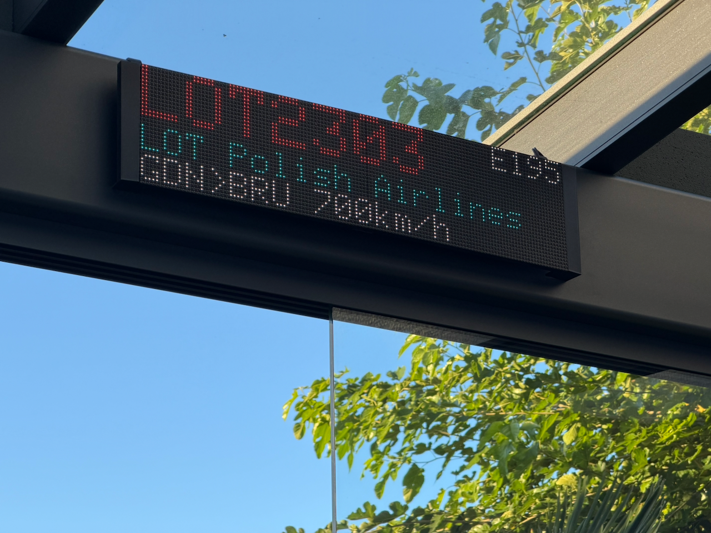
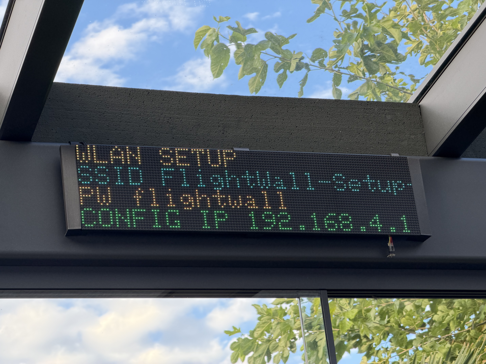

# FlightWall MatrixPortal

FlightWall ist eine eigenständige Flugzeuganzeige für den ESP32-S3. Das Projekt
liefert zwei gleichwertig gepflegte Firmwarevarianten: Der **Matrixcontroller**
steuert mit einem Adafruit MatrixPortal S3 zwei HUB75-Panels an; der
**Headless-Controller** läuft auf einem ESP32-S3-N16R8 ohne LED-Matrix und nutzt
die responsive FlightWall-Webseite als Anzeige. Beide Varianten lesen
ADS-B-Daten direkt ein, wählen das relevanteste Flugzeug aus und ergänzen Route
sowie Klartexte. Ein Raspberry Pi oder separater FlightMatrixServer ist nicht
erforderlich.



**Neu hier?** Die Anleitung [Getting Started](GETTING_STARTED.md) führt vom
Hardwareaufbau über die Ersteinrichtung bis zur ersten Flugzeuganzeige und
erklärt auch BME280, BH1750, MQTT, Routenauflösung und OTA.

Weitere Dokumentation:

- [Getting Started](GETTING_STARTED.md) – Aufbau und Ersteinrichtung
- [PlatformIO-Hinweise](PLATFORMIO.md) – Build, Upload und Entwicklung
- [Changelog](CHANGELOG.md) – Änderungen nach Firmwareversion
- [GitHub Releases](https://github.com/leliep/flightwall-matrixportal/releases) – fertige OTA-Images

## Schnellstart

1. Hardwarevariante auswählen: MatrixPortal mit 128×32-Matrix oder ESP32-S3
   N16R8 ohne Matrix.
2. Repository klonen und `include/secrets.h.example` nach
   `include/secrets.h` kopieren.
3. Erstmalige WLAN-Daten und optional ein OTA-Passwort eintragen.
4. Das zur Hardware passende PlatformIO-Environment per USB installieren.
5. `/config` öffnen und Standort, Blickrichtung, Radius sowie ADS-B-Quelle
   prüfen.
6. Unter `/status` den erfolgreichen ADS-B-Abruf kontrollieren und
   anschließend `/display` beziehungsweise die Matrix verwenden.

Die Kurzfassung ersetzt nicht die Hinweise zu Matrixstromversorgung,
unterschiedlichen Firmwareimages und WLAN-Rückfallmodus weiter unten.

## Inhalt

- [Hardware und Verkabelung](#hardware)
- [ADS-B-Daten und Flugzeugauswahl](#ads-b-daten-und-flugzeugauswahl)
- [Routen, Klartexte und Cache](#routen-klartexte-und-cache)
- [Matrixanzeige und Radar](#matrixanzeige)
- [Wetterseite und Schimmelrisiko](#wetterseite)
- [Weboberfläche](#weboberfläche)
- [Installation per USB](#installation-per-usb)
- [OTA-Updates](#ota-updates)
- [Übersetzungstabellen](#übersetzungstabellen-pflegen)
- [Diagnose und Tests](#diagnose-und-tests)
- [Betrieb und Fehlersuche](#betrieb-und-fehlersuche)
- [Sicherheit und Grenzen](#sicherheit-und-grenzen)

## Aktueller Stand

| Merkmal | Stand |
|---|---|
| Firmware | `3.6.1-dual-target.43` |
| Controller | Adafruit MatrixPortal S3 oder ESP32-S3 DevKitC-1 N16R8 |
| Anzeige Matrixcontroller | 2 × 64×32 HUB75 (128×32 Pixel) und Web-Display |
| Anzeige Headless-Controller | responsives Web-Display |
| Farbtiefe | 3 Bit je Farbkanal |
| Framework | Arduino über PlatformIO |
| Bedienoberfläche | Deutsch und Englisch |
| Aktualisierung | USB, Web-OTA oder PlatformIO-OTA |
| Gerätestatus | gemeinsame RGB-LED-Logik; zusätzlicher Betriebs-Pixel auf der Matrix |
| Lizenz | MIT |

Die aktuelle Firmware ist gezielt für **128×32 Pixel aus zwei horizontal
verketteten 64×32-Panels** ausgelegt. Ein einzelnes 128×64-Panel oder andere
Scanverfahren benötigen Änderungen an Matrixhöhe, Layout, Speicherbedarf und
Protomatter-Konfiguration und sind kein direkt unterstützter Ersatz.

## Eindrücke aus dem Betrieb

Die folgende Aufnahme zeigt den automatischen WLAN-Rückfallmodus direkt auf
der Matrix. SSID, Passwort und Konfigurationsadresse bleiben dadurch auch ohne
Zugriff auf den seriellen Monitor sichtbar.



[▶ Video: Flugzeuganzeige im laufenden Betrieb (MOV, ca. 22 MB)](IMG_4794.mov)

Das Video zeigt den realen Aufbau mit Callsign, Flugzeugtyp, CPA sowie
Annäherungsinformation. GitHub öffnet die MOV-Datei je nach Browser direkt oder
bietet sie zum Herunterladen an.

Wesentliche Funktionen:

- direkte Verarbeitung lokaler readsb-/dump1090-Daten und der externen
  adsb.fi-API
- Auswahl des nächsten geeigneten Flugzeugs einschließlich CPA-Berechnung
  und sekundengenauem Countdown in den letzten drei Minuten
- konfigurierbare Filter für Kleinflugzeuge und Maximalhöhe
- bevorzugte Behandlung interessanter Flugzeuge und Transpondernotfälle
- große Notfallseite und automatische Rotation mehrerer Notfallflugzeuge in
  Matrix- und Webanzeige
- tägliche Statistik und herunterladbares Tagesjournal der angezeigten
  Flugzeuge, Specials und Transpondernotfälle
- tägliche Special-Chronik für alle erkannten Sonderflugzeuge sowie eine
  nachvollziehbare Auswahlbegründung
- Routenauflösung über adsb.im mit kostenlosem ADSBDB-Fallback und
  verwaltetem RAM-/Flash-Cache sowie sichtbarer Qualitätsbewertung
- automatisches Failover zwischen den beiden lokalen ADS-B-Quellen und
  adsb.fi mit regelmäßiger Rückkehrprüfung zur bevorzugten Quelle
- vollständige Multi-Hop-Routen und kompakte Darstellung geschlossener Umläufe
- integrierte Flughafen- und Airline-Klartexte
- acht frei auswählbare und sortierbare Matrixseiten
- maßstabstreue Radaransicht über die gesamte Matrixbreite mit
  Standortzentrum, Blickrichtung, unverzerrtem Radiuskreis und bis zu
  64 gleichzeitig sichtbaren Flugzeugpunkten; bei deaktivierter Wetterseite
  auch im Leerlauf sichtbar
- responsive Webanzeige für iPhone, Tablet und Desktop; auf der
  Headless-Variante einschließlich kompaktem Live-Radar
- deutsch/englisch umschaltbare Matrix- und Weboberfläche
- BME280-Klimawerte, Schimmelrisiko und optionale MQTT-Wetterdaten
- BH1750-Helligkeitsautomatik mit sieben stabilen Helligkeitsstufen
- umfangreiche Status-, Test- und Diagnosefunktionen
- änderbare WLAN-Zugangsdaten mit geschütztem Einrichtungsnetz als Rückfallweg
- vollständige Konfigurationssicherung und -wiederherstellung als JSON-Datei
- Dual-Core-Betrieb mit voneinander getrennter Anzeige und Netzverarbeitung

## Systemaufbau

```text
readsb / dump1090 ─┐
                   ├─> ADS-B-Auswahl ─> Route/Klartexte ─┬─> LED-Matrix (optional)
adsb.fi ───────────┘          │                  │       └─> Web-Display
                              ├─> RGB-Status-LED ├─> Routencache
                              └─> Status-API     └─> unbekannte Codes

BME280 ───────────────> Klima-/Schimmelbewertung ─┐
Mosquitto ────────────> Wind/Böen/Regen ──────────┴─> Wetterseite
BH1750 ───────────────> automatische Helligkeit
```

Die Arduino-Hauptschleife läuft auf Core 1 und bedient Matrix, Tasten und
Sensoren. Eine FreeRTOS-Task auf Core 0 verarbeitet WLAN, ADS-B, Routen,
MQTT, Webserver und OTA. Flugzeug- und Wetterdaten werden über geschützte
Kopien zwischen beiden Bereichen übergeben.

## Hardware

### Unterstützte Varianten

| Variante | PlatformIO-Environment | Anzeige | optionale Sensoren | mDNS-Name |
|---|---|---|---|---|
| Matrixcontroller: Adafruit MatrixPortal S3 | `adafruit_matrixportal_esp32s3` | 128×32 HUB75-Matrix und Web | BH1750, BME280 | `matrixportal.local` |
| Headless-Controller: ESP32-S3 N16R8 | `esp32s3_n16r8_headless` | Web-FlightWall | BME280 | `flightwall-server.local` |

Beide Varianten verwenden denselben ADS-B-, Routen-, Klassifizierungs-,
Wetter-, Konfigurations-, Webserver- und RGB-Statuscode. Matrixansteuerung,
Taster, BH1750-Automatik und Matrixseiten werden nur im Matrix-Build
initialisiert. Ein optionaler BME280 wird beim Headless-Controller über SDA
GPIO 16 und SCL GPIO 17 angeschlossen. Einstellungen und Datenformate bleiben
zwischen beiden Varianten weitgehend identisch.

### Benötigte Komponenten: Matrixcontroller

- Adafruit MatrixPortal S3
- zwei kompatible 64×32-RGB-HUB75-Panels mit 1/16-Scan
- ausreichend dimensioniertes, stabilisiertes 5-V-Netzteil für die Panels
- zwei HUB75-Flachbandkabel
- WLAN mit Zugriff auf mindestens eine ADS-B-Quelle

### Benötigte Komponenten: Headless-Controller

- ESP32-S3-DevKitC-1-kompatibles Board mit ESP32-S3-N16R8-Modul
- USB-C-Datenkabel und geeignete USB-Stromversorgung
- WLAN mit Zugriff auf mindestens eine ADS-B-Quelle

Eine LED-Matrix, ein MatrixPortal, ein BH1750 und ein separates
5-V-Matrixnetzteil werden für diese Variante nicht benötigt. Das eigentliche
FlightWall-Display läuft im Browser auf iPhone, Tablet oder Desktop.

Optional:

- BH1750 zur automatischen Helligkeitsregelung
- BME280 für Temperatur, Luftfeuchte und Luftdruck
- Mosquitto-kompatibler MQTT-Broker für Wind und Regen

| Option | Matrixcontroller | Headless-Controller |
|---|---|---|
| BME280 | Status und Wetter-Ruheanzeige | Status/API; keine lokale Matrixseite |
| BH1750 | automatische Matrixhelligkeit | nicht verwendet |
| MQTT-Wetter | Wetter-Ruheanzeige und Status | Status/API; keine lokale Matrixseite |
| Browser | zusätzliche Anzeige und Bedienung | primäre Anzeige und Bedienung |
| adsb.im / ADSBDB | Routenauflösung | Routenauflösung |

### Matrixverkabelung

Die Panels werden horizontal verkettet:

```text
MatrixPortal HUB75 ─> IN Panel 1
OUT Panel 1 ────────> IN Panel 2
```

Beide Panels werden parallel aus dem separaten 5-V-Netzteil versorgt. Das
MatrixPortal, das Netzteil und beide Panels benötigen eine gemeinsame Masse.
Die Panels dürfen nicht aus dem USB-Anschluss des MatrixPortal gespeist werden.
Vor Änderungen an Datenkabeln oder Stromversorgung ist die 5-V-Versorgung
abzuschalten.

Die Firmware verwendet die fest verdrahteten HUB75-Signale des MatrixPortal S3:

| HUB75 | GPIO | HUB75 | GPIO |
|---|---:|---|---:|
| R1 | 42 | R2 | 38 |
| G1 | 41 | G2 | 39 |
| B1 | 40 | B2 | 37 |
| A | 45 | CLK | 2 |
| B | 36 | LAT | 47 |
| C | 48 | OE | 14 |
| D | 35 | E | nicht verwendet |

Andere Panelauflösungen, Scanverfahren oder Panels mit E-Adressleitung
benötigen eine angepasste Protomatter-Konfiguration.

### Sensoranschlüsse

Der BH1750 wird im aktuellen Aufbau am gelöteten I²C-Bus betrieben:

| BH1750 | MatrixPortal S3 |
|---|---|
| VIN | 3,3 V |
| GND | GND |
| SDA | A1 / GPIO 3 |
| SCL | A2 / GPIO 9 |

Die Adressen `0x23` und `0x5C` werden automatisch erkannt. Fällt der Sensor
aus, verwendet die Firmware die gespeicherte manuelle Helligkeit und versucht
regelmäßig eine erneute Erkennung.

Der BME280 wird auf `0x76` und `0x77` gesucht – zuerst am Bus GPIO 3/9 und
anschließend am STEMMA-QT-Bus GPIO 16/17. Er liefert:

- Umgebungstemperatur in °C
- relative Luftfeuchte in Prozent
- gemessenen Stationsdruck
- anhand der konfigurierten Standorthöhe auf Meereshöhe reduzierten Luftdruck
- Taupunkt, kritische Oberflächentemperatur und Schimmelrisiko

Die interne ESP32-S3-Temperatur steht zusätzlich als Diagnosewert bereit. Sie
ist keine Messung der Raumtemperatur.

### RGB-Status-LED

Beide Controller-Varianten verwenden ihre integrierte adressierbare RGB-LED mit
derselben Logik. Die Helligkeit ist in der Konfiguration als **aus**,
**schwach** oder **normal** wählbar. Während der konfigurierten Nachtruhe wird
die LED zusätzlich gedimmt.

| Farbe und Verhalten | Bedeutung |
|---|---|
| Orange beim Start | Firmware startet |
| Türkis blinkend | WLAN-Einrichtungsnetz ist aktiv |
| Blau blinkend | Verbindung mit dem konfigurierten WLAN wird aufgebaut |
| Grün mit kurzem hellerem Herzschlag | Normalbetrieb; auch die Hauptschleife ist aktiv |
| Orange blinkend | ADS-B-Daten fehlen oder sind nicht aktuell |
| Violett | Firmwareupdate läuft |
| Rot blinkend | Fehler |
| Rot schnell blinkend | Transpondernotfall `7500`, `7600` oder `7700` |
| Gelb für etwa 180 ms | manueller HTTP-/Webzugriff |

Regelmäßige Statusabfragen der Weboberfläche lösen den gelben Impuls nicht aus,
damit die LED im normalen Betrieb ruhig bleibt. Update, Fehler und Notfall
haben Vorrang vor der HTTP-Anzeige. Der aktuelle logische Zustand steht auch
als `status_led_state` in `/api/status`.

Beim Matrixcontroller bleibt zusätzlich der kleine Betriebs-Pixel unten links
erhalten. Er gehört zur LED-Matrix und ist unabhängig von der RGB-LED: weiß
bedeutet gültige ADS-B-Daten, rot einen Abruffehler. Beim Headless-Controller
gibt es naturgemäß nur die RGB-Status-LED.

## ADS-B-Daten und Flugzeugauswahl

Es stehen drei auswählbare Quellen zur Verfügung:

1. frei konfigurierbare lokale URL, typischerweise `aircraft.json`
2. zweite frei konfigurierbare lokale URL
3. externe [adsb.fi Open Data API](https://adsb.fi/)

Nur die aktive Quelle wird im regulären Betrieb abgefragt. Die beiden lokalen
Quellen akzeptieren das readsb-/dump1090-Format mit `aircraft`; adsb.fi liefert
das v3-Format mit `ac`. Zeitstempel in Sekunden und Millisekunden werden intern
vereinheitlicht. Die Standardabfrage erfolgt alle fünf Sekunden.

Für adsb.fi erzeugt die Firmware die URL automatisch aus Standort und
Anzeigeradius. Der abgefragte Radius ist groß genug für den verdoppelten
Special-Type-Radius. Die öffentliche API ist für persönliche,
nichtkommerzielle Nutzung vorgesehen; FlightWall bleibt mit einer Abfrage alle
fünf Sekunden deutlich unter dem Limit von einer Anfrage pro Sekunde.

### Auswahlregeln

Im Normalfall wird das nächstgelegene geeignete Flugzeug gewählt. Dabei gelten:

- normaler Anzeigeradius: frei konfigurierbar
- Special Type: doppelter Anzeigeradius
- optionaler Filter für Sport- und Kleinflugzeuge
- optionaler Filter für Flugzeuge oberhalb einer Maximalhöhe in ft
- frische Position erforderlich

Der Kleinflugzeugfilter berücksichtigt unter anderem Kategorie `A1`, Typen wie
`PRIM` und `C152`, Segler-/Ultraleicht-Beschreibungen sowie deutsche
Kennzeichen nach den Mustern `D-E…`, `D-K…` und `D-M…`. Ein erkannter Special
Type wird nicht allein wegen des Kleinflugzeugfilters verworfen.

Für Flugzeuge mit Geschwindigkeit und Track berechnet der ESP32 den Closest
Point of Approach (CPA), die Zeit bis zum CPA und ob sich das Flugzeug nähert
oder entfernt. In den letzten drei Minuten vor dem CPA wird die Restzeit auf
Matrix, Webdisplay, Statusseite und in den APIs sekundengenau heruntergezählt.

### Bodenverkehr

ADS-B-Meldungen mit `alt_baro: "ground"`, `ground` oder `on_ground` behalten
ihren Bodenstatus. Die Anzeige unterscheidet:

- `steht` bis einschließlich 3 km/h
- `rollt` oberhalb von 3 km/h
- `am Boden`, wenn keine brauchbare Geschwindigkeit vorliegt

Stehende Flugzeuge werden nicht ausgewählt. Rollende Flugzeuge können
erscheinen, wenn kein geeignetes fliegendes Flugzeug im normalen Radius
vorhanden ist. Im Radar wird Bodenverkehr orange dargestellt.

### Special Types

Military, German Airforce, Bundespolizei, Polizei, Regierung, Hubschrauber,
Luftschiff und A380 werden besonders klassifiziert und auf allen
Flugzeugseiten mit eigenen Symbolen dargestellt. Die Erkennung verwendet
ADS-B-Metadaten und bekannte Callsign-Muster. Dazu gehören unter anderem
`GAF…`, `VAD…`/`VADER…`, `SHO…`/`SHOCK…`, `BURRO…`, `HAMMER…`, `SMASH…`,
`CONAN…`, `FALCON…`, `THOR…`, `VIRUS…`, `SONIC…`, `FELON…`, `IAM…`,
`BPO…`, `POL…`, `HBT…`, `HUM…` und `NRW…`. Die vollständige, tatsächlich
verwendete Regelbasis steht in `include/CallsignClassifier.hpp` und
`src/AircraftProcessor.cpp`.

Die Statusseite zählt pro Kalendertag eindeutige Flugzeuge und weist den
Anteil der Specials aus. Specials werden zusätzlich nach Kategorie aufgeteilt.
Bis zu 4096 Flugzeug- und 256 Special-Identitäten werden über ICAO-Hexadresse,
Registrierung oder Callsign unterschieden. Die flüchtige Statistik wird um
Mitternacht Ortszeit sowie bei einem Neustart zurückgesetzt.

### Transpondernotfälle

Die Squawk-Codes erhalten immer höchste Priorität:

| Code | Anzeige | Bedeutung |
|---|---|---|
| `7700` | Emergency | allgemeiner Notfall |
| `7600` | Radio | Funkausfall |
| `7500` | Hijack | Entführung |

Diese Flugzeuge umgehen Anzeigeradius, Maximalhöhe und Kleinflugzeugfilter.
Eine zusätzliche, nicht abschaltbare Alarmseite zeigt Identität, Code,
Bedeutung und bei mehreren Notfällen deren Position in der Auswahl. Sind
mehrere Notfälle vorhanden, wechselt der Server alle zehn Sekunden zum
nächsten Flugzeug. Matrix und Webdisplay verwenden dieselbe Auswahl; der
Wechsel funktioniert daher auch in der Headless-Variante.

Das Webinterface kann ein bis drei Testflugzeuge für höchstens zwei Minuten
simulieren. Der Test verändert weder ADS-B-Daten noch gespeicherte
Einstellungen.

## Routen, Klartexte und Cache

Der optionale Routendienst fragt standardmäßig `https://adsb.im/api/0/routeset`
mit Callsign und aktueller Position ab. Er ergänzt:

- Airline beziehungsweise Betreiber
- Start, Ziel und Zwischenstopps
- kurze Airport-Codes
- kompakte deutschsprachige Airport- und Airline-Bezeichnungen

Findet der Primärdienst keine Route, kann die Firmware automatisch den
kostenlosen, schlüsselfreien Dienst ADSBDB abfragen. Das Ergebnis wird nur
übernommen, wenn Callsign und Lage des Flugzeugs zur Verbindung zwischen Start
und Ziel plausibel sind. ADSBDB dient ausschließlich als Fallback; eine bereits
gefundene Primärroute wird nicht ersetzt. Die Funktion ist in der
Konfigurationsseite abschaltbar. ADSBDB-Ergebnisse bleiben ausschließlich im
flüchtigen RAM-Cache und werden nicht in den permanenten Routencache kopiert.

Multi-Hop-Routen bleiben vollständig erhalten. Die ausführliche Matrixseite
scrollt beispielsweise:

```text
DUS>BUD>DUS
Duesseldorf > Budapest > Duesseldorf
```

Auf den Kompaktseiten wird ein geschlossener Umlauf ohne redundantes Endziel
als `DUS<>BUD` beziehungsweise `Duesseldorf <> Budapest` dargestellt. Eine
normale Route wie `DUS-FRA-JFK` bleibt vollständig `DUS>FRA>JFK`.

Der Routencache besitzt je 32 Plätze im RAM und im nichtflüchtigen Speicher.
Routen werden zusätzlich anhand der aktuellen Flugposition, Höhe,
Vertikalbewegung und Flugrichtung geprüft. Die dafür benötigten
Flughafenkoordinaten werden aus dem täglich aktualisierten, gemeinfreien
[OurAirports-Datensatz](https://ourairports.com/data/) erzeugt und fest in die
Firmware eingebaut. Der Controller muss OurAirports nicht zur Laufzeit
erreichen. Eine unplausible Route wird weder angezeigt noch gespeichert.
Kehrt dasselbe Callsign nach mindestens 30 Minuten zurück oder wird es von
einem anderen Flugzeug verwendet, wird sein vorhandener Cacheeintrag vor der
Abfrage entfernt.
Gültigkeitszeiten:

| Ergebnis | Gültigkeit |
|---|---:|
| gefundene Route des Primärdienstes | 6 Stunden |
| gefundene ADSBDB-Fallbackroute (nur RAM) | maximal 6 Stunden |
| nicht gefundene Route | 1 Stunde |
| militärisches/behördliches Einsatzrufzeichen | 30 Minuten |

Neue Ergebnisse werden zunächst im RAM gesammelt. Der Flash-Schreibvorgang
erfolgt bevorzugt, wenn kein Flugzeug angezeigt wird oder die Nachtruhe aktiv
ist; die Matrix wird dafür kontrolliert dunkel geschaltet. Die
Konfigurationsseite zeigt Callsign, Route, Alter, Speicherort und Zustand.
Einträge können einzeln gelöscht, für das aktuelle Flugzeug neu abgefragt oder
vollständig geleert werden. Statusseite, Routentest und Cachetabelle zeigen
zusätzlich, aus welcher Quelle das Ergebnis stammt.

Ab Version `.36` liegen auch sämtliche dauerhaft gehaltenen Texte des
RAM-Routencaches, Tagesjournals und der Special-Chronik im externen PSRAM.
Das betrifft unter anderem Callsigns, Flugzeugbeschreibungen, Airline- und
Flughafennamen, Routen und Auswahlbegründungen. Eintragsmetadaten und Zeiger bleiben
intern; für die aktuelle Flugzeuganzeige und Downloads entstehen weiterhin
vorübergehende normale Textkopien. Es gibt keine globale Umleitung der
Speicherverwaltung und keine Änderung der TLS-Einstellungen.

Die PSRAM-Texte teilen beim Kopieren zunächst ihren unveränderlichen Puffer.
Nur geänderte Texte benötigen eine neue Reservierung; identische Daten bei
wiederholten ADS-B-Abfragen reservieren keinen neuen Textspeicher. Beim
Ersetzen, Entfernen oder Leeren werden nicht mehr benötigte Puffer tatsächlich
freigegeben. Abgelaufene Cacheeinträge werden weiterhin erst beim entsprechenden
Zugriff entfernt, nicht durch einen zusätzlichen Timer. Spurdauer, Journalgrenzen (256/64 Einträge), Routencachegrenzen
(32 RAM-/32 Flashplätze), Ablaufzeiten und JSON-/CSV-Downloadformate bleiben
erhalten. Der persistente Flash-Routencache verwendet sein bisheriges Format.

Schlägt eine PSRAM-Textreservierung fehl, wird der vorbereitete Journal- oder
Cacheeintrag nicht übernommen. Bestehende Texte, Metadaten, Eintragszähler und die
Cache-Ersetzungsposition bleiben erhalten; eine neue Beobachtung kann dann
fehlen, bis wieder Speicher verfügbar ist. Routen können weiterhin direkt
angezeigt werden, auch wenn sie gerade nicht in den RAM-Cache übernommen
werden können. Es gibt keinen Rückfall auf internen Textspeicher. Ohne
funktionierenden PSRAM sind entsprechend keine neuen Journal-/Cachetexte
speicherbar; Gerätekonfiguration und gespeicherte Flashdaten werden nicht
verändert.

Die Statusseite zeigt belegte Textbytes, Anzahl der Textpuffer und fehlgeschlagene
Reservierungen. `/api/status` liefert diese Werte unter
`persistent_text_memory` als `storage: "psram"`, `allocated_bytes`, `blocks`
und `allocation_failures`. Die Bytezahl enthält die Referenzverwaltungsdaten
der Textpuffer, jedoch nicht den zusätzlichen Verwaltungsaufwand des
Speicherallokators. Gemeinsame Puffer werden nur einmal gezählt. Die
Fehlerzahl ist seit Start kumulativ. Gegenüber `.35` benötigt der Matrix-Build
zusätzlich rund 40,5 KiB weniger statischen internen RAM; das weitere Wachstum
der gespeicherten Texte belastet den externen Speicher.

Lokaler Regressionstest der PSRAM-Textverwaltung einschließlich tatsächlicher
Journal-/Cache-Aktualisierung, vollständiger Belegung, absichtlich simulierter
Reservierungsfehler sowie Reset- und Freigabepfade:

```bash
python3 tools/test_psram_text.py
```

## Matrixanzeige

Alle acht Flugzeugseiten können einzeln aktiviert, frei angeordnet und mit
einer Dauer von 2 bis 60 Sekunden versehen werden:

| Seite | Inhalt |
|---|---|
| Flugdaten | Callsign, Entfernung, Richtung, Höhe und Steig-/Sinkdreieck |
| Airline und Route | Airline, vollständige Routencodes und Geschwindigkeit |
| CPA und Sondertyp | CPA, Annäherung/Entfernung, Klassifizierung und ausführliche Flugzeugtypenbezeichnung |
| Flughafennamen | Codes und Langnamen; Multi-Hop vollständig gescrollt |
| Freitext | eigener Text bis 128 Zeichen, langsam/mittel/schnell |
| Kompaktansicht | Typ, Kerndaten, Blickrichtung, Route und CPA |
| Kompakt + Flughäfen | Airline, Typ, Kerndaten und dynamische Namenszeile |
| Radaransicht | Maßstabstreuer rechteckiger Ausschnitt über die volle Matrixbreite, Standortzentrum, Blickrichtung nach oben, Radiuskreis und bis zu 64 Flugzeugpunkte |

Lange Texte verlängern die Seitendauer automatisch, bis der Lauf vollständig
sichtbar war. Seiten ohne verwertbaren Inhalt werden übersprungen. Sanfte
Übergänge sind optional.

Auf **CPA und Sondertyp** läuft eine zu lange Detailzeile wie auf
**Kompakt + Flughäfen**: 0,8 Sekunden Startpause, Vorlauf mit 80 ms pro Pixel,
0,8 Sekunden Pause am Textende, Rücklauf mit 20 ms pro Pixel und 0,8 Sekunden
Pause am Anfang. Das Zeichenintervall beträgt 50 ms. Die Seitendauer wird bei
Bedarf bis zum vollständigen Vor-/Rücklauf einschließlich Pausen verlängert;
kurze Texte stehen still. Auch die separate Seite **Flughafennamen** verwendet diesen Vor-/Rücklauf
für Start und Ziel sowie bei Multi-Hop-Routen für die vollständigen Codes und
Flughafennamen. Die jeweils längste Zeile bestimmt die Mindestdauer; kürzere
Zeilen warten nach ihrem Rücklauf am Anfang. Auch hier beträgt das
Zeichenintervall 50 ms.

Die konkrete Typenbeschreibung kommt bevorzugt aus der ADS-B-Quelle. Fehlt sie
oder enthält sie nur eine allgemeine Angabe wie „Helicopter“, ergänzt eine
kleine lokale Tabelle derzeit Robinson R22, R44 und R66. Unbekannte Modelle
zeigen zumindest ihren ICAO-Typcode; eine Variante wie Raven II wird nicht aus
dem allgemeinen Code R44 geraten. Eine tatsächlich gelieferte ausführliche
Beschreibung bleibt erhalten. Die Ergänzung erfolgt zentral für Matrix,
Webdisplay und Journal, nach der bestehenden Klassifizierung. Es entstehen
keine zusätzlichen Netzwerkabfragen. Quelldatei ist
`data/aircraft_type_names.json`; Generator und Validator heißen
`tools/generate_aircraft_type_names.py` und `tools/validate_aircraft_type_names.py`.
Die Robinson-Zuordnung folgt den
[FAA Aircraft Type Designators](https://www.faa.gov/documentLibrary/media/Order/JO_7360.1G_Aircraft_Type_Designators_FINAL.pdf).


In der Radaransicht sind normale Ziele cyan, das ausgewählte Ziel gelb,
Specials violett, Bodenverkehr orange und Transpondernotfälle blinkend rot.
Der Standort erscheint grün im Zentrum. Der unverzerrte Kreis kennzeichnet
den normalen Auswahlradius. Seitliche Ziele außerhalb des Kreises werden mit
demselben Entfernungsmaßstab bis zum Matrixrand dargestellt, ohne dadurch die
normale Flugzeugauswahl zu verändern. Ist die Wetterseite deaktiviert, bleibt
das Radar auch ohne ausgewähltes Flugzeug als Leerlaufanzeige sichtbar. Ein
heller Punkt umläuft den Radius ausgehend von 12 Uhr im Uhrzeigersinn. Das
Intervall ist von 1 bis 10 Sekunden konfigurierbar; `0` schaltet den
Umlaufpunkt aus. Der Standardwert beträgt 5 Sekunden. Ein einzelner Umlauf
dauert etwa 0,8 Sekunden und endet sichtbar wieder am 12-Uhr-Startpixel.

Radarspuren zeigen auf Matrix und Headless-Webradar die beobachteten Positionen
der letzten 60 Sekunden als einzelne, mit dem Alter dunkler werdende Punkte.
Sie sind standardmäßig aktiv und unter **Radar → Radarspuren (60 Sekunden)**
abschaltbar. Bei kleinster Matrixhelligkeit bleiben die Spuren auf der kleinsten
sichtbaren Stufe. Identische Bildpunkte werden zusammengefasst; Linien und
vorhergesagte Positionen werden nicht gezeichnet. Empfangslücken über 15 Sekunden,
unplausible Positionssprünge sowie Änderungen von Quelle, Standort, Radaransicht
oder Filtern beginnen eine neue Spur. Auch das Speichern der Konfiguration
setzt die Spuren zurück. Die Verläufe liegen ausschließlich im RAM
und sind nach einem Neustart leer. Nur aktuell im Radar enthaltene Ziele erhalten
eine Spur; bei Abruffehlern laufen vorhandene Spurpunkte trotzdem nach 60 Sekunden ab.
Die Einstellung ist in Konfigurationssicherung und -wiederherstellung enthalten.

Ab Version `.35` liegen Verlaufsspeicher und beide Spur-Anzeigekopien in einem
beim Start einmalig reservierten **externen PSRAM-Block** (24.064 Byte auf dem
ESP32-S3). Interner RAM enthält nur die aktuellen Radarpositionen. Die bereits
vorhandenen PSRAM-Bausteine beider unterstützter Controller reichen dafür aus;
Spurdauer, maximal 64 Ziele und Darstellung bleiben erhalten. Beim Matrix-Build
belegt die Firmware dadurch rund 23,5 KiB weniger statischen internen RAM als
`.34-diag`. Die zusätzliche Reserve steht insbesondere den internen
TLS-Speicherzuteilungen der Routendienste zur Verfügung.

Kann der externe Speicher beim Start nicht reserviert werden, bleibt das
Live-Radar verfügbar und nur die Spuren werden für diese Laufzeit ausgelassen.
Es gibt bewusst keinen Rückfall auf großen internen Verlaufsspeicher, der das
TLS-Speicherproblem wieder auslösen würde. Die gespeicherte Spuren-Einstellung
bleibt unverändert. Konfiguration, Status und Headless-Webradar zeigen die
fehlende Verfügbarkeit an. `/api/status` und `/api/display` liefern zusätzlich
`radar_trails_available`; `/api/status` zeigt `radar_trails_storage_bytes` und
`free_psram_bytes`. `radar_trails_enabled` beschreibt weiterhin die gespeicherte
Auswahl; tatsächlich aktiv sind die Spuren nur bei aktivierter Auswahl und
verfügbarem Speicher. Die Routen-Verbindungsdiagnose bleibt zur Überprüfung
der internen Speicherreserven und möglicher weiterer TLS-Fehler erhalten.


Die Blickrichtung bezieht sich auf den Standort des Betrachters, nicht auf den
Track des Flugzeugs. Aus Standort, Entfernung, Höhe und Standorthöhe berechnet
die Firmware den vertikalen Blickwinkel. Unterhalb des konfigurierbaren
Grenzwerts – standardmäßig 30° – erscheint `weit`. Ab etwa 60° wird `oben`
ergänzt, ab 80° gilt das Flugzeug als direkt über dem Betrachter. Eine
Hysterese beruhigt die Anzeige an den Winkelgrenzen.

Wenn kein Flugzeug im Anzeigeradius liegt, erscheint wahlweise die Wetterseite.
Ohne Wetterseite blinkt unten links der zusätzliche Matrix-Betriebs-Pixel: weiß
bei gültigen ADS-B-Daten, rot nach einem Abruffehler. Dieser Pixel bleibt neben
der gemeinsamen RGB-Status-LED aktiv. Während der Radaransicht bleibt er im
fehlerfreien Betrieb dunkel und blinkt nur bei einer Störung rot. Display-Aus,
Nachtruhe, Flash- und OTA-Zustände haben Vorrang vor der normalen Seitenausgabe.

### Matrixansteuerung und Helligkeit

Adafruit Protomatter betreibt die Matrix mit 3 Bit Farbtiefe, Doppelbuffer und
einem angepassten ESP32-S3-DMA-Timing. Vollständige Seiten werden im
unsichtbaren Puffer aufgebaut und mit `matrix.show()` umgeschaltet. Vor
Seitenwechseln und zeitkritischen Flashzugriffen werden beide Puffer gezielt
bereinigt. Diese Kombination reduziert sporadische Störpixel bei gleichzeitig
feineren Farben als die frühere 2-Bit-Version.

Sieben native Helligkeitsstufen von 14 bis 100 Prozent vermeiden zeitliches
Dithering. Die BH1750-Automatik verteilt sie zwischen den konfigurierten
Lux-Schwellen. Manuelle Bedienung:

- **UP:** manueller Modus, heller
- **DOWN:** manueller Modus, dunkler
- **UP + DOWN:** Automatik aktivieren

## Wetterseite

Ist „Wetterdaten anzeigen, wenn kein Flugzeug in der Nähe ist“ aktiviert,
erscheinen alle verfügbaren Messwerte gemeinsam auf einer ruhigen Seite:

- BME280: Temperatur, Feuchte und auf Meereshöhe reduzierter Luftdruck
- MQTT: Windrichtung, Windgeschwindigkeit, Böen und Regen heute

Die obere Zeile enthält Temperatur, mittig Feuchte und rechts Luftdruck. Die
untere Zeile enthält Windrichtung, Windgeschwindigkeit, mittig Böen und rechts
Regen. `B` steht in der deutschen Oberfläche für Böen, `G` in der englischen
für *gusts*. Regen wird über MQTT in Zentimetern empfangen und für die Anzeige
in Millimeter umgerechnet. MQTT-Werte verfallen nach 15 Minuten ohne Update.

Broker, Port, Benutzer, Passwort und alle vier Topics sind im Webinterface
konfigurierbar. Windrichtung kann numerisch oder als kurze Himmelsrichtung
geliefert werden; numerische Werte werden in eine von 16 Richtungen umgesetzt.
Die Option für die Wetter-Ruheanzeige schaltet die gesamte Matrix-Wetterseite
ein oder aus. Auf dem Headless-Controller werden BME280- und MQTT-Werte
weiterhin in Status und API verarbeitet, aber nicht als lokale Ruheanzeige
dargestellt.

### Schimmelrisiko

Aus Temperatur und relativer Luftfeuchtigkeit berechnet die Firmware Taupunkt
und die Oberflächentemperatur, bei der 80 % relative Feuchte erreicht würden.
Das Ergebnis ist eine Orientierungshilfe, keine bauphysikalische Messung:

- unter 60 %: normal
- ab 60 %: erhöht; Feuchte erscheint gelb
- ab 75 % sofort oder ab 65 % für 30 Minuten: hoch; Feuchte erscheint rot
- ein hoher Zustand wird nach 15 Minuten unter 60 % zurückgenommen

Statusseite und `/api/status` liefern Risikostufe, Taupunkt, kritische
Oberflächentemperatur und Dauer erhöhter Feuchtigkeit.

## Weboberfläche

Nach erfolgreicher WLAN-Verbindung antwortet der Server auf Port 80:

| Pfad | Matrixcontroller | Headless-Controller | Funktion |
|---|---|---|---|
| `/` | `http://matrixportal.local/` | `http://flightwall-server.local/` | Weiterleitung zum Status |
| `/status` | `http://matrixportal.local/status` | `http://flightwall-server.local/status` | automatisch aktualisierter Status und Diagnose |
| `/config` | `http://matrixportal.local/config` | `http://flightwall-server.local/config` | Konfiguration ohne automatische Seitenaktualisierung |
| `/display` | `http://matrixportal.local/display` | `http://flightwall-server.local/display` | responsive FlightWall-Anzeige |
| `/api/display` | verfügbar | verfügbar | aktuelle Displaydaten als JSON |
| `/api/status` | verfügbar | verfügbar | vollständige Statusdaten einschließlich RGB-LED als JSON |
| `/unknown-codes.json` | verfügbar | verfügbar | unbekannte Airport-/Airline-Codes herunterladen |
| `/configuration.json` | verfügbar | verfügbar | vollständige Konfiguration herunterladen |
| `/journal.json` | verfügbar | verfügbar | heutiges Flugzeugjournal als JSON herunterladen |
| `/journal.csv` | verfügbar | verfügbar | heutiges Flugzeugjournal als CSV herunterladen |
| `/specials.json` | verfügbar | verfügbar | heutige Special-Chronik als JSON herunterladen |
| `/specials.csv` | verfügbar | verfügbar | heutige Special-Chronik als CSV herunterladen |
| `/update` | verfügbar | verfügbar | passwortgeschütztes Web-OTA |

Falls mDNS im Netz nicht funktioniert, kann statt des jeweiligen Namens die im
seriellen Monitor oder Router angezeigte IP-Adresse verwendet werden.
Werden mehrere Headless-Controller gleichzeitig betrieben, verwenden sie
denselben mDNS-Namen. In diesem Fall sollten die numerischen IP-Adressen oder
feste DHCP-Zuordnungen im Router verwendet werden.

Die Konfigurationsseite ist für iPhone, Tablet und Desktop optimiert. Kurze
Werte und zusammengehörige Optionen werden in einem kompakten, responsiven
Raster angeordnet; auf schmalen Displays ordnen sich die Felder automatisch
untereinander an. Die Seite verwaltet unter anderem WLAN-Zugang, Sprache,
Display, Wetterseite, Standort, Blickrichtung, ADS-B-Quelle, Filter,
Routendienst, MQTT, Seitenreihenfolge, Freitext, Helligkeit und Nachtruhe.
Statuskarten werden regelmäßig aktualisiert, ohne geöffnete Bereiche zu
schließen oder ungespeicherte Formulareingaben zu überschreiben.

### Wichtige Konfigurationsgruppen

| Bereich | Wesentliche Einstellungen |
|---|---|
| WLAN und Sprache | SSID, Passwort, Netzwerkscan, Deutsch/Englisch |
| Standort und Auswahl | Optionale Standortbezeichnung, Koordinaten, Höhe über NHN, Blickrichtung, Radius, Blickwinkel für `weit` |
| ADS-B | zwei lokale URLs, externe adsb.fi-Quelle, bevorzugte Quelle und Failover |
| Filter | Kleinflugzeuge ausblenden, Maximalhöhe in ft |
| Routen | adsb.im, ADSBDB-Fallback, Verbindungstest und Cacheverwaltung |
| Matrixseiten | Seiten aktivieren, Reihenfolge, Dauer, Übergänge, Freitext und Radar-Umlauf |
| Wetter | BME280-Ruheanzeige, MQTT-Broker, Zugangsdaten und Topics |
| Helligkeit | BH1750-Automatik, manuelle Stufe und Lux-Schwellen |
| Betrieb | Nachtruhe, RGB-LED-Helligkeit, Tests und Neustart |
| Sicherung | vollständige JSON-Sicherung und Wiederherstellung |

Bei den Standortkoordinaten lässt sich eine optionale **Standortbezeichnung**
mit bis zu 48 Zeichen hinterlegen, etwa „Büro München“ oder „Dachstation 2“.
Sie erscheint dezent bei den Standortdaten auf `/status`, als Eingabefeld auf
`/config` und unter dem Kopfbereich von `/display`, auch ohne aktuelles Flugzeug.
Ein leeres Feld blendet die Beschriftung aus. Umlaute, Leerzeichen und Satzzeichen
sind möglich; Steuerzeichen und ungültiges UTF-8 werden abgewiesen.
Die physische Matrixanzeige bleibt davon unberührt. Der Text wird gespeichert,
bei OTA erhalten und als `site_name` mit der Konfiguration gesichert.
Ältere Sicherungen ohne dieses Feld behalten eine vorhandene Bezeichnung bei;
eine ausdrücklich leere Bezeichnung löscht sie.

Matrixbezogene Felder werden im Headless-Build ausgeblendet. Einstellungen
werden im NVS gespeichert und bleiben bei normalen USB- und OTA-Updates
erhalten.

Im Abschnitt **Konfiguration sichern** kann der gesamte Gerätestand als
JSON-Datei heruntergeladen und später auf demselben oder einem Ersatzgerät
wiederhergestellt werden. Die Datei enthält auch WLAN-, MQTT- und
OTA-Zugangsdaten **im Klartext** und muss deshalb geschützt aufbewahrt werden.
Ist OTA eingerichtet, verlangt der Download dieselben Zugangsdaten wie die
Update-Seite. Die Sicherungsdatei selbst ist weder verschlüsselt noch durch ein
zusätzliches Passwort geschützt. Eine Wiederherstellung ersetzt die gesamte
Konfiguration und startet den Controller anschließend neu.

Ist das ADS-B-Failover aktiviert, verwendet die Firmware bei einem Fehler
sofort eine andere konfigurierte Quelle. Die bevorzugte Quelle wird danach
einmal pro Minute erneut geprüft. Statusseite und `/api/status` unterscheiden
zwischen bevorzugter und tatsächlich verwendeter Quelle.

Die Seite `/display` zeigt Callsign, Typ, Airline/Special Type, vollständige
Route, Entfernung, Höhe, Geschwindigkeit, CPA, Vertikalbewegung und
Blickrichtung. Sie aktualisiert sich automatisch und ist unabhängig vom
128×32-Layout gestaltet. Auf der Headless-Variante enthält sie zusätzlich ein
kompaktes Live-Radar im Seitenverhältnis der Matrix. Es verwendet dieselbe
Orientierung, Entfernungsskala und Farblogik wie das Matrixradar.

Deutsch/Englisch wirkt gemeinsam auf Matrix, Konfiguration, Diagnose,
Web-Display und Wetterkürzel. Airport-, Airline- und Freitextnamen werden nicht
automatisch übersetzt.

## Installation per USB

### Voraussetzungen

- Git
- VS Code mit PlatformIO-Erweiterung oder PlatformIO Core
- USB-C-Datenkabel
- Zugangsdaten für das WLAN

Repository laden:

```bash
git clone https://github.com/leliep/flightwall-matrixportal.git
cd flightwall-matrixportal
cp include/secrets.h.example include/secrets.h
```

In `include/secrets.h` mindestens WLAN-Name und Passwort eintragen:

```cpp
constexpr char WIFI_SSID[] = "mein-wlan";
constexpr char WIFI_PASSWORD[] = "mein-wlan-passwort";

#define OTA_PASSWORD "ein-langes-ota-passwort"
#define MQTT_PASSWORD ""
```

Die Werte `WIFI_SSID` und `WIFI_PASSWORD` dienen als erstmalige beziehungsweise
werkseitige Zugangsdaten. Danach können WLAN-Name und Passwort über die
Konfigurationsseite geändert werden; die gespeicherten Werte bleiben bei
Firmwareupdates erhalten.

`OTA_PASSWORD` benötigt mindestens acht Zeichen und dient nur noch als
Startwert. Das OTA-Passwort kann anschließend auf der Konfigurationsseite
gesetzt, geändert oder deaktiviert werden und bleibt in NVS gespeichert. Damit
können auch die öffentlichen GitHub-Builds ohne eingebettetes privates Passwort
nach der ersten USB-Installation für OTA eingerichtet werden.
`include/secrets.h` wird von Git ignoriert und darf nicht eingecheckt werden.

### WLAN später ändern

Unter **WLAN-Zugang** kann ein neuer WLAN-Name mit neuem Passwort gespeichert
werden. Ein leeres Passwortfeld behält das vorhandene Passwort bei; für ein
offenes Netz steht eine eigene Auswahl zur Verfügung. Nach einer Änderung
startet der Controller automatisch neu.

**WLANs suchen** startet auf Wunsch einen asynchronen Umgebungsscan. Die Liste
ist nach Signalstärke sortiert, fasst gleichnamige Netze zusammen und zeigt
SSID, Empfangspegel und Verschlüsselung. Eine Auswahl übernimmt die SSID in das
weiterhin frei editierbare Eingabefeld; bei einem offenen Netz wird die
entsprechende Option gesetzt. Versteckte oder während des Scans nicht sichtbare
Netze können unverändert von Hand eingetragen werden. Es finden keine
automatischen Dauerscans statt.

Kann der Controller das gespeicherte WLAN nicht erreichen, öffnet er ein
Einrichtungsnetz mit einem gerätespezifischen Namen nach dem Muster
`FlightWall-Setup-123ABC`:

| Einstellung | Wert |
|---|---|
| Passwort | `flightwall` |
| Konfigurationsadresse | `http://192.168.4.1/` |

Das Einrichtungsnetz leitet Browseraufrufe auf die Konfigurationsseite um und
wird nach einer erfolgreichen Verbindung mit dem normalen WLAN wieder beendet.
Solange es aktiv ist, zeigt die Matrix dauerhaft WLAN-Name, Passwort und
`CONFIG IP 192.168.4.1` an. Ein zu langer WLAN-Name läuft als Laufschrift.

MatrixPortal kompilieren und per USB übertragen:

```bash
pio run -e adafruit_matrixportal_esp32s3
pio run -e adafruit_matrixportal_esp32s3 -t upload
```

Headless-Server für das ESP32-S3-N16R8-Board kompilieren und übertragen:

```bash
pio run -e esp32s3_n16r8_headless
pio run -e esp32s3_n16r8_headless -t upload
```

Bei mehreren angeschlossenen seriellen Geräten zuerst den USB-Port ermitteln
und ausdrücklich angeben (hier als Beispiel unter macOS):

```bash
pio device list
pio run -e esp32s3_n16r8_headless -t upload \
  --upload-port /dev/cu.usbmodem101
```

Ein normaler USB-Upload ersetzt Bootloader, Partitionstabelle und Firmware,
lässt aber die im NVS gespeicherte WLAN- und Anwendungskonfiguration bestehen.
Das ist für Updates und Ersatzcontroller meist erwünscht. Soll ein bereits
benutztes Board vollständig neu eingerichtet werden, muss es vor dem Upload
gezielt gelöscht werden; dabei gehen alle gespeicherten Einstellungen verloren.

Die beiden Firmwaredateien liegen anschließend unter:

```text
.pio/build/adafruit_matrixportal_esp32s3/firmware.bin
.pio/build/esp32s3_n16r8_headless/firmware.bin
```

Die Images sind **nicht austauschbar**: Das Matrix-Image initialisiert HUB75,
Taster und die Matrixsensorik, das Headless-Image lässt diese Hardware bewusst
aus. Die Update-Seite nennt deshalb die erkannte Gerätevariante.

Beim ersten USB-Upload kann es je nach Board und USB-Modus erforderlich sein,
BOOT gedrückt zu halten, kurz RESET zu betätigen und BOOT wieder loszulassen.
Nach erfolgreicher Installation genügt normalerweise ein gewöhnlicher Upload
oder OTA. Der im Betrieb sichtbare USB-Port kann sich vom Bootloader-Port
unterscheiden.

Der serielle Monitor läuft mit 115200 Baud:

```bash
pio device monitor -b 115200
```

Nach dem ersten Start `http://matrixportal.local/config` öffnen und mindestens
Standort, Blickrichtung, aktive ADS-B-Quelle und Anzeigeradius kontrollieren.
Die mitgelieferten Standardwerte sind auf den ursprünglichen Aufbau
zugeschnitten und nicht als allgemeine Standortvorgabe gedacht.

GitHub Actions baut bei Push und Pull Request beide Firmwarevarianten mit den
Platzhalterwerten aus `include/secrets.h.example` und stellt beide BIN-Dateien
als getrennte Build-Artefakte bereit.

| GitHub-Actions-Artefakt | Zielgerät | enthaltene Datei |
|---|---|---|
| `flightwall-matrixportal-s3` | Adafruit MatrixPortal S3 mit HUB75-Matrix | `firmware.bin` |
| `flightwall-esp32s3-n16r8-headless` | ESP32-S3 DevKitC-1 N16R8 ohne Matrix | `firmware.bin` |

Zum Herunterladen unter **Actions → letzter erfolgreicher „PlatformIO
Build“-Lauf → Artifacts** das zum Controller passende ZIP auswählen. Die
Build-Artefakte sind nicht direkt als Binärdateien im Git-Repository
eingecheckt.

### Fertige Release-Images

Für stabile Versionen ist **Releases → Latest** der bevorzugte Downloadweg.
Ein Versionstag im Format `v<APP_VERSION>`, beispielsweise
`v3.6.1-dual-target.33`, veröffentlicht nach zwei erfolgreichen Builds
automatisch:

- `flightwall-matrixportal-<VERSION>.bin`
- `flightwall-headless-<VERSION>.bin`
- `SHA256SUMS.txt`
- `firmware-manifest.json`

Der Workflow bricht ab, wenn Tag und `APP_VERSION` nicht exakt übereinstimmen.
Das Manifest nennt für beide Hardwarevarianten Dateiname, Größe, SHA-256-Wert
und Quell-Commit. Dadurch lassen sich vertauschte oder beschädigte Images vor
dem Web-OTA erkennen. Normale Build-Artefakte bleiben zusätzlich für jeden
erfolgreichen Commit verfügbar.

`main` kann bereits eine neuere, erfolgreich gebaute Entwicklungsversion als
das jüngste getaggte Release enthalten. In diesem Fall stehen die aktuellen
Images zunächst als GitHub-Actions-Artefakte oder nach lokalem Build bereit.

## OTA-Updates

Das erste OTA-fähige Image muss per USB installiert werden. Danach gibt es
zwei Wege.

### Web-OTA

1. `http://matrixportal.local/update` öffnen.
2. Mit Benutzer `admin` und dem `OTA_PASSWORD` anmelden.
3. Das MatrixPortal-Image aus dem aktuellen GitHub Release oder lokal
   `.pio/build/adafruit_matrixportal_esp32s3/firmware.bin` auswählen.
4. Upload bestätigen und den automatischen Neustart abwarten.

Die Seite prüft Dateiendung und ESP32-Dateikopf, zeigt den Fortschritt und
vergleicht nach dem Neustart alte und neue Firmwareversion.

Für den Headless-Server lautet die Adresse
`http://flightwall-server.local/update`; dort muss die Datei aus
`.pio/build/esp32s3_n16r8_headless/` beziehungsweise das mit `headless`
bezeichnete Release-Image verwendet werden. Die Update-Seite zeigt die
installierte Hardwarevariante ausdrücklich an. Images der beiden Varianten
dürfen nicht miteinander vertauscht werden.

### PlatformIO-OTA

```bash
export MATRIXPORTAL_OTA_PASSWORD='ein-langes-ota-passwort'
pio run -e adafruit_matrixportal_esp32s3_ota -t upload
```

Das Passwort steht bewusst nicht in `platformio.ini`. Die VS-Code-Aufgabe
**FlightWall: Git-Update + OTA** führt zunächst ein Fast-forward-Update von
`origin/main` aus, fragt das Passwort verdeckt ab und startet anschließend den
Upload.

Vor jedem geplanten Neustart oder OTA sollten die Listen unbekannter Airports
und Airlines auf der Statusseite geprüft und neue Codes in die Quelldaten
übernommen werden, da diese Beobachtungen nur im RAM liegen.

## Übersetzungstabellen pflegen

### Lookup-Ergänzungen ohne Firmwareupdate

Unter `/config` → **Lookup-Ergänzungen verwalten** beziehungsweise `/lookups`
werden zusätzliche Airportnamen, Koordinaten und Airlines unabhängig von der
Firmware hochgeladen. Anmeldung: Benutzer `admin` mit dem bestehenden
OTA-Passwort; ohne eingerichtetes OTA-Passwort ist der Upload gesperrt.
Jeder Controller erhält die Datei separat. Es gibt keinen automatischen Download.

1. Bei der ersten Verwendung gegebenenfalls **Lookup-Speicher einrichten**
   wählen. Diese ausdrücklich bestätigte Aktion formatiert nur die vorhandene
   Datenpartition für die Lookup-Dateien; NVS-Konfiguration, OTA-Slots und
   Matrix-UF2 bleiben erhalten. Bei einem späteren Mountfehler nicht ungeprüft
   formatieren: Auch ein beschädigtes oder fremdes Dateisystem kann die Ursache sein.
2. Beispieldatei herunterladen, ergänzen und als JSON auswählen. Vorhandene
   Ergänzungen vorher herunterladen und in der neuen Datei beibehalten.
3. **Prüfen und übernehmen** ersetzt den gesamten Ergänzungsbestand. Es findet
   kein Neustart statt. Neue Namen werden beim nächsten Flugdatendurchlauf auch
   aus dem bestehenden Routencache aufgelöst; alte Journale werden nicht umgeschrieben.

Format (vollständiges Beispiel: `data/lookup_extensions.example.json`):

```json
{
  "format": "flightwall-lookups-v1",
  "version": "example-1",
  "airports": [
    {"code": "DUS", "name": "Düsseldorf", "latitude": 51.2895,
     "longitude": 6.76678, "elevation_ft": 147}
  ],
  "airlines": [{"code": "DLH", "name": "Lufthansa"}]
}
```

Alle vier Hauptfelder sind erforderlich. Flughafen-Codes haben 3–4,
Airline-Codes 2–4 Großbuchstaben/Ziffern; Codes müssen innerhalb ihrer Tabelle
eindeutig sein. Jeder Flughafen benötigt beide Koordinaten und `elevation_ft`
als ganze Zahl zwischen −1500 und 30000 oder `null`. Namen müssen gültiges UTF-8
ohne Steuerzeichen sein, maximal 28 Zeichen für Airports bzw. 64 für Airlines;
die Datenversion enthält 1–64 Zeichen. Grenzen: 64 KiB und je 256 Einträge.
Ergänzungen haben bei Lookups Vorrang vor dem eingebauten Grundbestand.
Eine Datei mit leeren Arrays entfernt alle Ergänzungen und stellt den Grundbestand her.

Eine Datei aus den gepflegten Quellen erzeugen:

```bash
python3 tools/generate_lookup_extensions.py --version local-1 \
  --airports DUS --airlines DLH BNJ JFL --output work/lookup-extensions.json
```

### Unbekannte Codes recherchieren und Bestände zusammenführen

`tools/research_lookup_extensions.py` fragt standardmäßig beide Controller
lesend ab, lädt ihre vorhandenen Ergänzungen und erstellt einen gemeinsamen
Bestand. Namen/Koordinaten kommen zuerst aus den lokalen Quelltabellen;
fehlende Airports werden über OurAirports, fehlende ICAO-Airlines über die
aktuelle FAA-Designatortabelle recherchiert. Die Software setzt Python 3.9+
voraus und benötigt keine zusätzlichen Python-Pakete.

```bash
python3 tools/research_lookup_extensions.py \
  --version local-2 \
  --output work/lookup-extensions.json \
  --report work/lookup-review.json
```

Für andere Geräteadressen `--controller http://ADRESSE` je Gerät wiederholen.
Das jeweilige OTA-Passwort wird verdeckt abgefragt. Es gibt keine Passwortoption
in der Kommandozeile; Zugangsdaten werden weder gespeichert noch im Bericht
veröffentlicht. Eine Eingabe ohne geschütztes Terminal wird abgewiesen.
Für die Geräte sind ausschließlich GET-Abfragen implementiert; Zugangsdaten
werden bei HTTP-Weiterleitungen nicht weitergereicht. Es gibt keinen Upload,
keine Änderung von Einstellungen und keinen Neustart.

Die Ausgabe umfasst die gemeinsame Lookup-Datei sowie einen JSON-Prüfbericht
und eine lesbare Markdown-Fassung gleichen Namens. Der Bericht enthält
Controller-/Datenversionen, erhaltene Einträge, neue Daten, Quellen mit
Abrufzeitpunkt und SHA-256, relevante Quellzeilen, Konflikte und offene Punkte.
Nur generische Flughafen-Endungen werden bei Bedarf aus zu langen Namen
entfernt; jede solche Anpassung erscheint im Bericht. Es wird kein
identifizierender Name blind abgeschnitten oder geraten. Die FAA-Quelle
liefert ICAO-Codes; fehlende zweibuchstabige Airline-Codes bleiben offen.

Vorhandene Ergänzungen haben Vorrang vor Recherchedaten. Identische Einträge
beider Geräte werden zusammengeführt. Unterschiedliche Angaben zum selben
Code erscheinen mit beiden Versionen im Konfliktbericht, ohne automatische
Auswahl. Ebenso blockieren nicht erreichbare Controller, unvollständige
Code-Listen nach Überlauf, mehrdeutige Quellen, fehlende Angaben und ungültige
oder zu große Daten die Freigabe einer Upload-Datei.

**Nur bei Status `ready` und Rückgabecode 0 wird die Upload-Datei geschrieben.**
Bei Status `blocked` (Rückgabecode 2) bleibt eine bereits vorhandene Datei am
Ausgabepfad unverändert; sie gehört dann nicht zum neuen Lauf. Der aktuelle
JSON-Bericht weist `output_written: false` aus. Bei Freigabe enthält er auch
die Prüfsumme der neu erzeugten Datei. Konflikte müssen vor dem manuellen
Upload geklärt werden. Anschließend dieselbe geprüfte Datei auf beiden
Controllern hochladen; das Recherchewerkzeug führt diesen Schritt nicht aus.

Mit `--airports-csv DATEI` und `--airlines-html DATEI` lassen sich lokale
Quellsnapshots verwenden; der Bericht kennzeichnet diese und dokumentiert
ihre Prüfsummen. Die Daten können veraltet sein und müssen dann geprüft werden.

Tests mit zwei simulierten Controllern, Bestands-/Konfliktfällen und Quellen:

```bash
python3 tools/test_research_lookup_extensions.py
```

### Speicher der Lookup-Ergänzungen

Die vorhandenen Partitionstabellen bleiben unverändert:

| Variante | Datenpartition | Dateisystem | Größe |
|---|---|---|---|
| MatrixPortal | `ffat`, Offset `0x450000` | FAT/FFat | 3.6875 MiB |
| Headless N16R8 | `spiffs`, Offset `0xc90000` | LittleFS | 3.375 MiB |

Die Tabelle beschreibt die Partitionen; nutzbarer Dateisystemplatz ist wegen
Verwaltungsdaten kleiner. Zwei abwechselnde Dateien mit Rückleseprüfung und
CRC sowie ein separat gespeicherter aktiver Dateizeiger schützen die vorherige
Version bei fehlgeschlagenen Updates. Der Zeiger wird erst nach Schließen und
Aushängen des Dateisystems in einem eigenen NVS-Namespace geändert.
Firmware-OTA überschreibt diese Dateien nicht. `uploadfs`, Neuformatierung oder
vollständiges Flash-Löschen können sie entfernen; deshalb separat herunterladen.
Die Konfigurationssicherung enthält die Ergänzungsdatei nicht.

Uploadpuffer und JSON-Daten liegen ausschließlich im PSRAM, zusammen auf 1 MiB
begrenzt. Dateisystemtreiber benötigen während des Zugriffs zusätzlich interne
Puffer; das Dateisystem bleibt im normalen Betrieb ausgehängt. Fehlerhafte oder
zu große Dateien, fehlender PSRAM sowie Schreib-/Prüffehler aktivieren keinen
neuen Bestand. Beim Start mit unlesbarer Datei bleibt der Grundbestand verfügbar.

Statusseite und `/api/status` zeigen unter `lookup_overrides` Datenversion,
Airport-/Airlineanzahl, Dateigröße, Partitionskapazität, reservierte PSRAM-Bytes,
Reservierungsfehler und den letzten Fehler. Aufgelöste Codes werden nach einem
Upload aus den unbekannten Listen entfernt; Überlaufzähler bleiben erhalten.

Lokale Tests mit realem Parser, beiden generierten Lookup-Varianten und
simulierten PSRAM-, Datei- und NVS-Fehlern:

```bash
python3 tools/test_lookup_overrides.py
python3 tools/test_lookup_upload.py
```

### Eingebauten Grundbestand pflegen

Die editierbaren Quellen liegen hier:

- `data/airport_names.de.json`
- `data/airline_names.de.json`
- `data/airport_coordinates.json` (aus OurAirports erzeugt)

Die C++-Dateien in `src/*.generated.cpp` werden daraus erzeugt und sollten
nicht direkt bearbeitet werden:

```bash
python3 tools/generate_airport_names.py
python3 tools/generate_airline_names.py
python3 tools/generate_airport_coordinates.py
python3 tools/validate_airport_names.py
python3 tools/validate_airline_names.py
python3 tools/validate_airport_coordinates.py
pio run
```

Nach dem Ergänzen neuer Flughafencodes wird die Koordinatentabelle mit
`python3 tools/update_airport_coordinates.py` aus dem aktuellen
OurAirports-Datensatz aktualisiert. Das optionale Argument ist der Pfad zu
einer bereits heruntergeladenen `airports.csv`.

Empfohlene Reihenfolge vor einem Controllerneustart:

1. unbekannte Codes auf **beiden** Controllern prüfen oder herunterladen,
2. Codes und Klartexte in die JSON-Quelldateien eintragen,
3. bei Flughäfen zusätzlich Koordinaten und Höhe ergänzen,
4. generierte C++-Tabellen neu erzeugen und alle Validatoren ausführen,
5. beide Firmwarevarianten bauen und erst danach OTA beziehungsweise Neustart
   durchführen.

Unbekannte Codes werden während des Betriebs flüchtig gesammelt – jeweils bis
zu 32 Airports und Airlines. Die Statusseite und `/api/status` zeigen die
gesammelten Listen und mögliche Überläufe. Über **Codes herunterladen (.json)**
oder `/unknown-codes.json` lässt sich jederzeit eine Datei für die spätere
Tabellenpflege sichern. Der Download löscht keine Einträge. Nach einem Neustart
sind diese Beobachtungen verloren.

## Diagnose und Tests

Die Statusseite zeigt unter anderem:

- Firmwareversion, Build, Laufzeit und Neustartgrund
- Hardwarevariante sowie Zustand und Helligkeitsmodus der RGB-Status-LED
- freien internen Heap, Minimum seit Start und größten zusammenhängenden
  freien internen 8-Bit-Speicherblock (vor Aufbau der Statusantwort gemessen)
- aktuelle IP, Hostname, verbundene und gespeicherte SSID,
  Signalqualität, Gateway, Subnetz, DNS, WLAN-Kanal, MAC-Adresse,
  Einrichtungsnetz und Wiederverbindungen
- aktive ADS-B-Quelle, Abrufalter, empfangene und geeignete Flugzeuge
- aktuelles Flugzeug, Route, CPA, Filter und Routencache
- unbekannte Airport-/Airline-Codes
- tägliche Gesamt-, Special- und Notfallstatistik mit Erfassungsbeginn
- BME280-, Schimmel-, MQTT- und BH1750-Werte
- Matrix-Farbtiefe, Bildwiederholrate sowie letzte/maximale `show()`-Dauer
- maximale Laufzeiten einzelner Netzwerkphasen und Taskdiagnose

### Automatische WLAN-Wiederherstellung

Ab `.45` wird das WLAN auch dann neu verbunden, wenn es weiterhin als verbunden
erscheint, aber mindestens fünf vollständige ADS-B-Abrufzyklen über mindestens
90 Sekunden ausschließlich mit Transportfehlern enden. Alle im jeweiligen Zyklus
versuchten Quellen müssen betroffen sein. Jede ADS-B-HTTP-Antwort, auch ein Fehlerstatus,
oder eine funktionierende MQTT-Verbindung unterbricht diese Fehlerfolge.
JSON-, Konfigurations- und explizite HTTPClient-Speicherfehler zählen nicht dazu.
Ein alleiniger Ausfall aller verwendeten Dienste kann dieselben Transportfehler
verursachen; deshalb gilt zwischen Wiederherstellungen eine Sperrzeit von fünf Minuten.

Dabei wird nur die WLAN-Verbindung erneuert, ohne Controller-Neustart und ohne
Änderung gespeicherter Einstellungen oder Lookup-Ergänzungen. Webserver, MQTT
und OTA werden über den bestehenden Wiederverbindungspfad wieder gestartet.
Während OTA, ausstehendem Neustart oder vorbereiteter Routencache-Schreibphase
wird keine solche Wiederherstellung ausgelöst. Schlägt die Anmeldung fehl,
bleiben das Einrichtungsnetz und die regulären WLAN-Wiederholungen verfügbar.

`/api/status` enthält `wifi_transport_failure_cycles`, `wifi_transport_recoveries`
und `last_wifi_transport_recovery_age_seconds`. Die serielle Ausgabe meldet den
Auslöser und anschließend den regulären Verbindungsaufbau. Zähler gelten seit Start.

### Routen-Verbindungsdiagnose

Seit Diagnoseversion `3.6.1-dual-target.34-diag` erfasst die Firmware echte HTTP-Abfragen
beim Hauptdienst und beim ADSBDB-Fallback getrennt. Unter **Status →
Routen-Verbindungsdiagnose** stehen Quelle, Callsign, Anzahl und Alter der
Anfragen, Dauer, HTTP-Code sowie der negative Fehlercode des Secure-Clients.
Bei einem konkreten mbedTLS-Fehler erscheinen zusätzlich Hexadezimalcode und
Fehlertext. Der allgemeine Secure-Client-Code `-1` und ein fehlender TLS-Code
werden ausdrücklich als **ohne TLS-Details** gekennzeichnet; daraus lässt sich
kein bestimmter DNS-, Socket- oder TLS-Fehler ableiten. Ein HTTP-Fehler nach
erfolgreichem TLS-Aufbau wird nicht als TLS-Fehler ausgegeben.

Der interne, byteweise adressierbare RAM wird an drei Grenzen gemessen:

1. vor dem Erzeugen des Secure-Clients und der Anfrage,
2. unmittelbar vor `POST` beziehungsweise `GET`,
3. unmittelbar nach deren Rückkehr, vor Fehlertextaufbereitung und `http.end()`.

Jede Messung enthält freien RAM, den größten zusammenhängenden freien Block
und das Heap-Minimum seit dem Start. Die verwendete TLS-Bibliothek nutzt
internen Speicher; PSRAM wird diesen Werten nicht zugerechnet. Die Messungen
sind **keine Messung innerhalb des TLS-Handshakes**: Die Bibliothek kann ihre
TLS-Puffer bei einer fehlgeschlagenen Verbindung bereits vor der Rückkehr
freigegeben haben. Auch das Heap-Minimum ist ein Wert seit Gerätestart und
kein isoliertes Minimum der einzelnen Routenabfrage.

In `/api/status` stehen die Werte unter:

- `route_memory`: aktueller interner Heap vor Aufbau der API-Antwort
- `route_diagnostics.primary`: letzte HTTP-Anfrage des Hauptdienstes
- `route_diagnostics.fallback`: letzte HTTP-Anfrage des ADSBDB-Fallbacks
- `route_diagnostics.last_failure`: letzter Verbindungs-/HTTP-Fehler, auch wenn
  spätere Anfragen erfolgreich sind oder Routen aus dem Cache kommen

Noch nicht vorhandene Abfragedatensätze sind `null`. Die Datensätze enthalten
`http_attempted`, `http_code`, `tls_error_code`, `tls_error_hex`,
`tls_error_detail_available`, `tls_error_text`, `started_ms`, `age_seconds`,
`duration_ms` und die Speicherstände `entry`, `before_request`, `after_request`.
Die Speicherfelder heißen `free_internal_bytes`, `largest_internal_block_bytes`
und `minimum_internal_bytes`; alle Größen sind Bytes. Die Dauer beginnt vor
der Anfragevorbereitung und endet nach dem Empfang der HTTP-Antwortheader.

Cachetreffer lösen keine neue Messung aus; Callsign und Alter zeigen, zu welcher
Anfrage die Diagnose gehört. HTTP 404 beim ADSBDB-Dienst bedeutet keine gefundene
Route und ersetzt den gespeicherten Verbindungsfehler nicht. Die Aufzeichnung
liegt mit 732 Byte festem Speicher ausschließlich im RAM, benötigt bei der
Erfassung keine zusätzlichen dynamischen Textpuffer und endet mit einem
Neustart. URLs, Positionen und Zugangsdaten werden nicht in die neuen
Diagnosedatensätze aufgenommen. Routenwahl, Cache-Regeln, TLS-Einstellungen und
Controllerkonfiguration bleiben unverändert.

Lokale Diagnoseprüfungen ohne Controller:

```bash
c++ -std=c++11 -Wall -Wextra -pedantic -Iinclude tools/test_route_diagnostics.cpp -o /tmp/flightwall-route-diagnostics
/tmp/flightwall-route-diagnostics
python3 tools/test_route_diagnostic_output.py
c++ -std=c++11 -Wall -Wextra -pedantic -Iinclude tools/test_route_callsign.cpp -o /tmp/flightwall-route-callsign
/tmp/flightwall-route-callsign
python3 tools/test_route_validation.py
```

### Verfügbare Tests


- ADS-B-Verbindungstest der ausgewählten Quelle
- Routendiensttest mit frei eingegebenem Callsign
- Transpondernotfalltest mit einem bis drei Flugzeugen
- etwa 23 Sekunden langer Matrixtest mit Farben, Raster, Linien, Text,
  Farbbalken und allen Special-Type-Symbolen

Die Tagesstatistik zählt jedes frische Flugzeug anhand ICAO-Hexadresse,
Registrierung oder Callsign nur einmal. Bis zu 4096 Flugzeuge und 256 Specials
werden im RAM verfolgt. Der Reset erfolgt um Mitternacht lokaler NTP-Zeit und
zusätzlich bei jedem Neustart; die Statusseite zeigt den tatsächlichen
Erfassungsbeginn und beide Kapazitätsgrenzen.

Das Tagesjournal hält zusätzlich bis zu 256 tatsächlich zur Anzeige ausgewählte
Flugzeuge im RAM. Für jeden Eintrag werden erster und letzter Sichtzeitpunkt,
Flug, Typ, Route, Klassifizierung sowie kleinste Entfernung und kleinster CPA
fortgeschrieben. Die Statusseite zeigt aus Stabilitätsgründen die neuesten 64
Einträge in umgekehrter zeitlicher Reihenfolge; die JSON- und CSV-Downloads
enthalten das vollständige Journal. Journal und Tagesstatistik werden gemeinsam
bei lokalem Datumswechsel oder Neustart gelöscht.

Die Flugkennungen in Tagesjournal und Special-Chronik verlinken auf die
zugehörige FlightAware-Seite in einem neuen Tab. Ohne Flugkennung bleibt die
Hex-Kennung normaler Text. Der Link bezeichnet die Flugkennung, nicht zwingend
den historischen Flug zum Zeitpunkt des Eintrags; JSON-/CSV-Exporte bleiben unverändert.

Die Special-Chronik erfasst unabhängig von der Anzeige bis zu 64 Specials und
Transpondernotfälle, die der aktive ADS-B-Empfänger innerhalb des
Verarbeitungsbereichs liefert. Sie enthält Klassifizierung, ersten und letzten
Zeitpunkt, Typ, minimale Entfernung und CPA sowie die Information, ob das
Flugzeug tatsächlich angezeigt wurde. Für das aktuelle Flugzeug und jeden
angezeigten Journaleintrag nennt FlightWall außerdem den Auswahlgrund:
Transpondernotfall, nächstes Special im doppelten Radius oder geringste
Entfernung unter den geeigneten Kandidaten.

Der Netzwerk-Task läuft mit niedriger Priorität und kurzen Scheduler-Pausen,
damit synchrone HTTP-, TLS- und MQTT-Aufrufe den ESP32-Task-Watchdog nicht
blockieren. Bei WLAN-Verlust werden mDNS, MQTT und OTA kontrolliert beendet;
der Webserver bleibt über das Einrichtungsnetz erreichbar und die normalen
Netzdienste werden nach der Wiederverbindung neu gestartet.

## Betrieb und Fehlersuche

Für den normalen Betrieb empfiehlt sich folgende kurze Kontrolle:

- `/status` zeigt eine aktuelle ADS-B-Antwort ohne Fehler,
- bevorzugte und tatsächlich aktive ADS-B-Quelle stimmen überein oder das
  Failover ist nachvollziehbar aktiv,
- unbekannte Codes und Überlaufzähler werden vor geplanten Neustarts geprüft,
- BME280, MQTT und BH1750 werden nur dann als Fehler bewertet, wenn sie im
  eigenen Aufbau tatsächlich verwendet werden,
- OTA-Updates werden ausschließlich mit dem zur Hardware passenden Image
  durchgeführt.

| Symptom | Prüfung |
|---|---|
| Gerät nicht per Namen erreichbar | numerische IP im Router oder seriellen Monitor verwenden; mDNS-Unterstützung des Clients prüfen |
| Keine Flugzeuge | aktive ADS-B-URL testen, Zeitstempel und Positionen in `aircraft.json` prüfen, Radius/Filter kontrollieren |
| Falsche oder fehlende Route | Routentest und Cachequelle ansehen, Eintrag gezielt löschen oder neu abfragen |
| Matrix dunkel | Displayfreigabe, Nachtruhe, Helligkeit, 5-V-Versorgung und HUB75-Richtung prüfen |
| Wetterseite fehlt | Wetter-Ruheanzeige aktivieren; BME280- und MQTT-Status kontrollieren |
| WLAN nicht erreichbar | mit `FlightWall-Setup-…` verbinden und `http://192.168.4.1/` öffnen |
| Webserver träge | Zahl gleichzeitiger Browser reduzieren und Netzwerkdiagnose auf `/status` prüfen |
| OTA schlägt fehl | Hardwarevariante, OTA-Passwort, Dateiendung, freien Netzwerkzugriff und ausreichend lange Uploadzeit prüfen |

## Wiederherstellung und Git

Der Stand vor der Integration der Serverfunktionen ist mit dem Tag
`pre-flightmatrix-integration-2026-10-04` gesichert:

```bash
git fetch --tags
git switch -c restore-pre-integration pre-flightmatrix-integration-2026-10-04
```

Aktualisierung eines bestehenden Checkouts ohne lokale Änderungen:

```bash
git switch main
git pull --ff-only origin main
```

## Projektstruktur

| Pfad | Inhalt |
|---|---|
| `src/main.cpp` | Display, Webserver, Sensorik, MQTT, OTA und Laufzeitlogik |
| `src/AdsbClient.cpp` | ADS-B-Abruf und JSON-Parsing |
| `src/AircraftProcessor.cpp` | Filter, Auswahl, CPA und Klassifizierung |
| `src/RouteClient.cpp` | Routendienst und Cache |
| `src/WebDisplay.cpp` | responsives FlightWall-Web-Display |
| `src/StatusLed.cpp` | gemeinsame RGB-Statuslogik beider Controller-Varianten |
| `data/` | Airport- und Airline-Quelldaten |
| `tools/` | Prüfung und Erzeugung der Lookup-Tabellen |
| `include/secrets.h.example` | Vorlage ohne echte Zugangsdaten |
| `platformio.ini` | Build- und OTA-Umgebungen |
| `CHANGELOG.md` | chronologische Änderungen |
| `GETTING_STARTED.md` | schrittweise Ersteinrichtung einschließlich optionaler Komponenten |
| `PLATFORMIO.md` | ergänzende Entwicklerhinweise |
| `IMG_4482.png` | Beispiel einer Flugdatenseite im realen Aufbau |
| `IMG_4788.jpeg` | WLAN-Einrichtungsanzeige im realen Aufbau |
| `IMG_4794.mov` | kurzes Video der laufenden Flugzeuganzeige |

## Sicherheit und Grenzen

- Konfiguration, Status und JSON-APIs besitzen keine eigene Anmeldung. Das
  Gerät ist für ein vertrauenswürdiges lokales Netz gedacht.
- Die OTA-Seite ist mit Benutzername und Passwort geschützt. Der Download der
  vollständigen Konfiguration verwendet bei aktiviertem OTA dieselbe
  Anmeldung; Status, normale Konfiguration und Wiederherstellungs-Endpunkt
  bleiben im lokalen Netz ohne eigene Anmeldung erreichbar.
- Die erzeugte Konfigurationsdatei enthält Geheimnisse unverschlüsselt.
- Das Einrichtungsnetz verwendet das dokumentierte Standardpasswort
  `flightwall`. Es sollte nur vorübergehend und nicht als dauerhaftes
  Betriebsnetz aktiv sein.
- HTTPS-Verbindungen sind verschlüsselt, die Firmware validiert die
  Serverzertifikate derzeit jedoch nicht, weil beim frühen Systemstart noch
  keine verlässliche Uhrzeit garantiert ist.
- Bei aktivierten externen Diensten werden Callsign und Flugzeugposition an
  den konfigurierten Routendienst beziehungsweise Standort und Radius an
  adsb.fi übertragen. MQTT-Zugangsdaten bleiben im Gerät, werden aber bei
  unverschlüsseltem Port 1883 im lokalen Netz ohne TLS verwendet.
- Routen und Klartexte hängen von Verfügbarkeit und Qualität externer Daten ab.
- CPA und aktueller Streckenabschnitt sind berechnete beziehungsweise
  abgeleitete Werte und keine Flugsicherungsinformationen.
- Wetter- und Schimmelanzeige ersetzen keine kalibrierten Messgeräte oder
  bauphysikalische Begutachtung.

## Lizenz

MIT – siehe [LICENSE](LICENSE).
